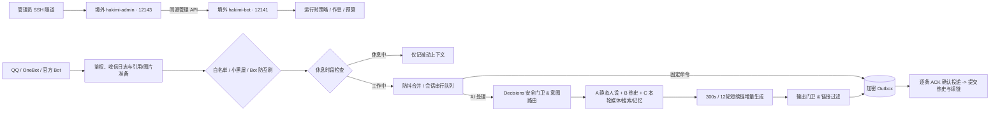

# 哈基米跨平台冲浪助手（Hakimi Surf）

**当前版本：v2.1.0** · 基于 Python 3.12+ 与 FastAPI 的 QQ AI 冲浪后端，支持 OneBot v11（NapCat HTTP / 正向 WS / 反向 WS）与官方 QQ Bot Webhook，后端默认对接 Gemini `Interactions` 与 `Decisions`。

设计目标很直接：**在群里像个懂分寸的活人损友，在私聊只偏心真正的主人；记性好、会贴表情回戳、能结合记忆逛 B 站，同时把注入和越权操作关在服务端裁决边界内。**

> 如果想直观查看全链路模块关系，可以直接下载或浏览器打开离线 [可视化项目架构图 (architecture.html)](architecture.html)。

---

## 核心能力一览

| 模块 | 能做什么 | 默认保护边界 |
| :--- | :--- | :--- |
| **群聊分寸感与丰富互动** | 白名单群内支持被点名搭话与“智能自由插话”；支持消息 **贴 QQ 表情（`emoji_like`）** 与 **戳一戳（`poke`）**（即使不发文字也可无声贴表情/回戳），私聊与群聊均可发表情包 | 群聊只用平视口吻，绝不读取主人私聊记忆；外部 Bot 默认 0.85 高门槛防互刷（1.00 为 0 Token 完全屏蔽） |
| **高清看图与代码/文件排版** | 支持拉取当前、引用与紧邻群图（默认 16 MiB / 50 MP，超长图双切片）；支持读群/私聊 `.log`/`.py`/`.json`/`.yaml` 等纯文本报错文件（默认 128 KiB）；群聊含多行代码块或 Markdown 表格自动发高清排版卡片图 | 文件读取严格白名单扩展名，拒绝 `.env`/二进制/内网 SSRF 与本地路径；卡片由本地 Pillow 渲染且模式/文件上限均可在 `/admin` 热调 |
| **自主表情库与个性签名** | 聊天收到好图或收到“收下/偷图”请求时可自主收录本地表情包；与真实 Owner 对话且合意时可自主更新 QQ 个性签名 | 最多 100 张本地 JPEG；自动改签仅限已验签的真实 `OWNER_QQ_ID` 会话触发 |
| **双轨记忆与巡逻日记** | 每会话独立加密 SQLite（超过 **14,000 Token** 自动折半，半价 Flex 提炼画像与编年史，遇 Flex 503/429 自动退避重试）；巡逻日记本地记录公开巡逻与群活动计数，授权归档后可收录白名单聊天、B 站巡逻还会结合记忆兴趣选片 | 会话库彼此物理隔离，私聊记忆不会串进群聊上下文；日记仍经过秘密/注入脱敏过滤并写入隔离 Drive 目录 |
| **B 站视频冲浪与追更** | 群内自然聊天与私聊共享 B 站视频均可自主读字幕或原片摘要；B 站小号巡逻优先参考近期主人与群聊兴趣选片，且误报的 Gemini 抖动不再标成 `bili_account_failed` | 无字幕或需画面细节时走受限原片分析（兼容横/竖屏 ≤540p、≤480s、≤80 MiB），**本地预检失败不扣每日次数** |
| **免费联网 + DeepSeek 自动切换** | 群聊自然接话与 `/搜索` 均支持联网核实；**联网费用不计入 `/admin` 账单扣账与余额**；按自然月统计 Google 搜索次数，前 **5,000 次**走原生 Google Search，满额自动切换 **DeepSeek Search / Chat API** | 联网独立运行、绝不导出任何私人记忆与会话历史；DeepSeek API Key 使用 `Fernet` 加密存在本地 SQLite |
| **作息管理与账本余额** | 支持每日定时休息（默认北京时间 **23:00–08:00**）；世界引擎统一安排 B 站小号巡逻和日间陪伴，并在当日活跃时段结束前发一份 Owner 日报；`/admin` 可手动设置账户当前余额并随后续非联网消费实时扣减 | `/admin` 可一键开启/暂停休息时段与“主人私聊照常响应”例外；所有主动发送底层锁定唯一 `OWNER_QQ_ID` |

---

## 三步快速部署

### 1. 准备配置文件
```bash
cd /root/Document/hakimi-surf
python3 scripts/init_env.py
```
`init_env.py` 会生成 `0600` 权限的安全 `.env`（若已存在则拒绝覆盖，防止误覆密钥）。编辑 `.env`，至少填入：
- `HAKIMI_GEMINI_API_KEY`（Gemini API Key）
- `ONEBOT_SELF_ID`（机器人 QQ 号）及对应的 OneBot / QQ Bot 鉴权凭证
- `OWNER_QQ_ID`（唯一真实主人的 QQ 号）
- `ADMIN_TOKEN`（进入 `/admin` 控制台的管理员口令）

> **⚠️ 请务必备份 `.env` 中的 `HAKIMI_ENCRYPTION_KEY`**。数据库与记忆文件全部使用该密钥加密；一旦丢失或擅自更换，旧数据将无法解密启动。

### 2. Docker 一键部署（推荐）
首次部署：
```bash
docker compose up -d --build
curl --noproxy '*' --fail http://127.0.0.1:12141/healthz
curl --noproxy '*' --fail http://127.0.0.1:12143/healthz
```

提交日常改动后运行发布脚本。它按服务构建镜像、验活，并为更新的服务保留回滚镜像。
```bash
bash scripts/deploy_prod.sh
```

<details>
<summary>本机开发启动 &amp; 跨境（境内 NapCat + 境外主脑）推荐拓扑说明</summary>

**单独启动引擎进行本机开发（需要 Python 3.12+ 与 `uv`）。联调管理页面时使用上面的双服务 Compose**：
```bash
uv sync --frozen
uv run uvicorn hakimi.app:create_app --factory \
  --host 127.0.0.1 --port 12141 --workers 1 --no-access-log --no-proxy-headers \
  --ws websockets-sansio --ws-max-size 16777216 --ws-max-queue 2 \
  --ws-ping-interval 25 --ws-ping-timeout 30 --ws-per-message-deflate false
```
> 必须保持 **1 个 Uvicorn worker**：进程内维护了会话串行调度、WS 连接状态与事务锁定，不能靠加 worker 水平扩展。

**跨境反向 WSS 拓扑**：
- **境内节点（NapCat）**：使用 `docker-compose.napcat.yml`，`network.websocketClients` 配置指向 `wss://你的域名/ws/onebot/<随机后缀>`，消息格式选 Array，开启 `enableLocalFile2Url`，25s 心跳 / 5s 重连。
- **境外主脑（Hakimi）**：引擎与管理台分别监听回环端口 `12141`、`12143`。公网 Nginx 精确放行 OneBot 和已启用的境内执行节点 WSS 路径，其余路径统一 404（模板见 [deploy/hakimi-ws.conf](deploy/hakimi-ws.conf)）；管理后台永不暴露公网。详见 [跨境部署说明](docs/CROSS_BORDER_DEPLOYMENT.md)。

</details>

---

## 聊天指令速查表

> 所有管理与权限指令均由服务端验签并代码裁决，不经过大模型，也不能通过群名、昵称或 Prompt 注入假冒授权。

### 日常互动与看片（白名单群 & 获准私聊）
| 输入 | 作用 | 说明 |
| :--- | :--- | :--- |
| `@机器人` / 叫名字 / 回复机器人的消息 | 正常对话、看图、贴表情/回戳 | 连续多条气泡会在防抖窗口内合并回复；支持纯贴表情/回戳不刷屏 |
| BV 号 / `bilibili.com/video/BV…` / `b23.tv` / B 站卡片 | 总结视频内容 | 白名单群内正常互动与私聊均可触发读取字幕与原片摘要 |
| `/搜索 <问题>` 或 `/search <问题>` | 显式联网检索 | 需先在后台启用联网搜索；群内自由接话和私聊均可在需要时自动检索，不计入账单余额 |
| `/哈基米 帮助` | 查看帮助说明 | 纯本地输出，0 Token 消耗 |
| `/new-session` | 清空当前上下文热史 | 不改变记忆开启/关闭状态；群内仅 Owner 可执行 |
| `/哈基米 记忆 开` / `记忆 关` / `清空` | 开关或彻底清除记忆 | 群内仅 Owner 可操作，私聊好友可管理自己的独立会话 |

### Owner 专属管理指令（仅真实 `OWNER_QQ_ID` 可用）
| 输入 | 作用 | 使用范围 |
| :--- | :--- | :--- |
| `/存表情 <标签>`（或 `/偷表情`） | 把当前附图或**引用到的群友图片/表情包**一键存入表情库（1～24 字标签） | **私聊 & 群内**（即使 `at_only` 群未 @ 也可引用触发） |
| `/deep <问题或 B 站链接>` | 强制本轮使用最高思考档位深入回答 | 仅 Owner 私聊 |
| `/哈基米 状态` | 查看今日全局预算花费与预留额度 | 仅 Owner 私聊 |
| `/哈基米 订阅 <UP主UID>` / `退订 <UID>` | 订阅或退订 UP 主更新巡逻 | 仅 Owner 私聊 |
| `/哈基米 订阅列表` / `报告` | 查看已订阅 UP 主与最近 7 天巡逻摘要 | 仅 Owner 私聊 |
| `/mute <QQ>` / `/unmute <QQ>` | 将指定 QQ 加入或移出小黑屋（加 `--delete-friend` 可顺带删好友） | 仅 Owner 私聊 |
| `/mute-approve <编号>` / `/mute-reject <编号>` | 审批多次触发风控群友的屏蔽提案 | 仅 Owner 私聊 |
| `/set-sign <签名>` | 手动更新机器人 QQ 个性签名（≤50 字纯文本） | 仅 Owner 私聊 |
| `/bot-interact <话题>` | 在群内显式允许本机与 `@` 到的外部 Bot 互动（限时 10 分钟 / 2 轮） | 真实 Owner 在获准群内 |

---

## Web 管理台（`/admin`）

页面、样式、脚本和内容安全策略随管理镜像发布。保存设置和触发任务时，后台把同源请求交给引擎的 `/admin/api/*`。引擎校验口令及来源，独占 SQLite、模型凭证、定时器和两个境内连接。旧隧道指向 12141 时，引擎从管理容器取回同一份页面。12142 供 Drive 授权回调使用。

提交界面改动后运行 `bash scripts/deploy_prod.sh admin`，它只发布管理服务。默认 `bash scripts/deploy_prod.sh` 按两个服务各自的改动选择发布对象。

独立管理台 `hakimi-admin` 只映射服务器回环地址 `127.0.0.1:12143`，在本地电脑建立 SSH 隧道后打开浏览器访问 `http://127.0.0.1:12141/admin`：

```bash
ssh -N -L 127.0.0.1:12141:127.0.0.1:12143 你的用户名@服务器IP
```

后台做出的绝大部分修改都会加密保存在 SQLite 中，**无需重启立即生效**，并可一键恢复回 `.env` 初始值：
- **作息与节奏**：一键开关每日休息时间、调整起止时刻与主人私聊例外；热调 0–30s 防抖窗口、每分钟限流、发送延迟；
- **模型、余额与费用账本**：在「模型与思考」选择全局主模型 Hydrogen、Neon 或 Carbon。核心和已安装插件各自提供思考场景，后台按声明显示可选档位，保存即生效。输出上限可独立调整；实时查看输入/输出/思考 Token、前缀缓存有效覆盖率；**手动设置当前账户余额并实时随后续消费扣减**；
- **联网引擎切换**：在「回复与联网」查看本月已用 Google 搜索次数（默认 `5,000` 次/月）与 DeepSeek 状态，加密配置 `DEEPSEEK_API_KEY`、Base URL 与备选模型；
- **图片、文件与记忆**：原图体积与总像素上限、常规/长图缩放边长、**纯文本/报错文件开关、体积上限、单人日配额与代码块/表格卡片模式**、热历史折半阈值（默认 14000 Token）、检索/锁定/擦除双轨记忆条目；
- **表情包仓库**：支持**多选或拖拽批量上传**（自动从文件名提取标签，也可在待传队列统一/单独命名），GIF/WebP 自动截取首帧转无元数据 JPEG；
- **安全门卫与准入**：热增删白名单群与私聊好友、调整各群活跃度Preset、外部 Bot 阈值、查看最近 30 条脱敏 Decisions 审计；
- **B 站小号与测试沙盒**：安全加密保存 B 站小号 Cookie、原片看片开关与配额、不发真消息的实时沙盒调试。

**群聊称呼分两档。** 在已放行的群里，正文中的「吉米奈喵、吉米奈、杰米奈喵、杰米奈、哈基米、大小姐」属于明确点名，跳过插话分数。「小小姐、猫猫、猫猫小姐、Gemini」属于可能称呼，英文大小写均可。门控结合最近群聊区分「猫猫，你在吗？」这样的呼唤和「我家猫猫睡着了」这样的闲聊。仅点名模式也会评估可能称呼，静默群保持静默。两档均须通过安全审核，只识别群友自己输入的正文。

---

## 进阶配置与日常维护

### 巡逻日记与模块文件同步

在「功能模块 → 巡逻日记」按日期预览本地 Markdown 和日记投递记录。「功能模块 → Google Drive 同步」按调用模块展示同步用途、最近尝试、最近成功和失败原因。每天 23:55 生成当日总结，离线后可补办，手动汇总复用同一天的付费尝试。「模型与思考 → 巡逻日记」管理总结档位。

Drive 凭据与隔离文件夹配置齐全后，每两小时及当日收尾同步有变化的日记。缺少配置时照常生成本地日记。授权失效或网络错误会记录失败原因并按退避时间重试，上传任务直接读取本地内容。

- 支持 **Service Account**（需把 Shared Drive 指定子文件夹分享给服务账号，对应 `compose.roaming.yaml`）或 **个人网盘 OAuth**（通过 `ssh -L 12142` 运行 `.venv/bin/python scripts/authorize_drive.py` 引导授权，只申请受限 `drive.file` 权限，对应 `compose.roaming-oauth.yaml`）。
- 既有 `HAKIMI_ROAMING_ENABLED` 继续作为敏感归档授权，亦可用 `HAKIMI_ARCHIVE_AUTHORIZED_DATA` 配置。授权涵盖白名单聊天原文及原有 Owner 镜像和备份导出。默认只整理公开材料和群活动计数。Owner 日报单独选择标注为公开的巡逻摘要、世界事件和群活动计数。私聊原文、未标明来源的旧报告均不会进入日报输入。群记忆的 Drive 同步仍按群控制。

### 在管理台核对世界引擎

- 在「世界引擎 → 世界作息与调度」设置入睡、起床时间和 Owner 私聊例外。定时睡眠每 4 分钟恢复 1 点精力。规划器可在活跃时段选择小憩，精力低于 30 时引擎也会就地安排休息，每 6 分钟恢复 1 点。小憩会为当日日报预留时间，清醒空闲与免打扰单独计算。
- **今日行程**随 Bot 的本地日期更新。启用定时睡眠时，起床即做一次全日规划。关闭定时睡眠时，每个本地自然日从零点开始可规划。晨间规划默认用 `medium`，在「模型与思考 → 世界引擎与公共服务」可选 `high`。若早晨离线，恢复后会在当天还有可用时段时补做。起床早于免打扰结束时可以先排计划，内部活动可以立即执行，主动消息等到免打扰结束。
- 「模型与思考」按插件声明装载场景。Hydrogen 和 Neon 支持到 `xhigh`，Carbon 支持到 `high`。单独切换主模型会保留之前的场景偏好，后台只列出当前模型及场景支持的档位。[Google 思考档位说明](https://aistudio.google.com/docs/thinking#thinking-levels)
- **白天调整**。规划器在定期复查或收到重要公开事件时读回当天行程和执行进度，可以保留、新增、改期或取消尚未开始的自主事项。后台「今天的行动与规划」显示当前安排、执行结果和晨间规划来源。预算关闭或模型暂时不可用时沿用本地规划。
- 在「功能模块 → QQ → 群聊与私聊隐私」设置群聊和普通私聊的默认等级，也可以单独调整一个会话。高隐私使用付费 Decisions 审核。Hydrogen 对所有会话使用「全局模型通道」的设置。

- **日报送达**。在「世界引擎」查看生成、入队及 QQ 确认时间。QQ 确认表示 OneBot 返回有效消息编号。断线期间已生成的加密正文可以在允许时段继续发送，回执不确定的记录保留供核对。
- **规划与费用**。每轮列出触发来源、候选与采纳数、筛选原因及模型费用。「Token 与预算账本」可按动作编号查账，部分用量未知时会单列预算扣账。相同状态下由本地延后，重要公开事件可提前唤醒规划。
- **七日观测**。管理台按实际运行日记录规划次数、节省的调用和下次行动。日报窗口关闭后，分别统计 90 秒内启动与窗口内收到 QQ 回执的次数。正在进行或缺少观测的晚上单独显示。
- **B 站观看历史**。「学习完成」只计入已保存学习结果的视频。公开资料读取失败后可有限重试，已交给模型后中断或旧版仅标记为尝试的视频保留待核实。

### 常用维护命令
```bash
# 查看汇总运行状态（可直接在宿主机进入容器或本机 venv 执行）
docker compose exec hakimi-bot python -m hakimi.admin status

# 若因实际用量异常超出预留触发了「预算熔断」，核对上游账单无误后可手工解除：
docker compose stop hakimi-bot
docker compose run --rm hakimi-bot python -m hakimi.admin clear-budget-circuit
docker compose up -d

# 本机代码检查与全量测试（全模拟 Mock，不产生真实 API 计费）
.venv/bin/ruff check .
.venv/bin/ruff format --check .
.venv/bin/pytest -q
```

---

## 系统架构与安全隐私底座

### 主动动作与扩展模块 · v2.1.0

生活引擎按注册的动作名调度。B 站每学完一个视频产生一条观看事实，建造灵感规则可据此创建内部 `mc.build_plan`。境内确认后记录“已登记计划”。MC 的重要进展可以另起一张 `qq.speak` 票据，发送前重新检查 Owner 或群白名单、预算、免打扰与会话状态。

| 入口 | v2.1.0 的行为 |
| --- | --- |
| 生活引擎 → 主动动作 | 查看动作的执行模块、就绪状态及原因。可逐项切换按动作名路由、旧票据路由、对照模式或停用。对照模式只比较本地映射，实际处理一次。 |
| 生活引擎 → 意图与事件 | 追踪来源事件、目标、门控与投递结果。每条规则独立消费同一事实。明确未派发可以在票据有效期内再试，回执不明记为 `uncertain`。 |
| 升级旧库 | 启动时增补列、索引与规则游标，保留旧票据和终态。新规则从启用时开始消费；重启从已保存的位置补读。 |
| 天气观测 | 在后台「功能模块 → 天气观测」搜索城市、填写经纬度，或按服务器出口 IP 识别城市。确认地点并保存后立即生效，重启后保留。也可恢复到 `.env` 的 `HAKIMI_WEATHER_LATITUDE`、`HAKIMI_WEATHER_LONGITUDE`。AI 可按需选择只读动作 `weather.read`，其他模块可调用 `await service.life_engine.query("weather.read")`，后台的「查询当前天气」使用受鉴权的 `GET /admin/api/life/modules/weather/current`。三者共用同一份观测，数据有效期取自 Open-Meteo 的时间戳和采样区间。查询返回气温、天气状况及可用的降水等观测值。[天气数据接口](https://open-meteo.com/en/docs) |

### 让其他社交平台复用群聊与私聊

社交插件在 `chat_platforms` 声明其协议名，在自己的连接上验证事件后，通过 `service.accept_from(module, message)` 提交消息。插件校验本平台准入并负责文本投递，共享管道处理防抖、安全审核、费用和历史。会话键包含部署命名空间、平台、机器人账号、会话类型和会话 ID。私聊使用已验证的对方用户 ID 作为会话 ID，适配器自行解析平台的投递地址。现有 OneBot 图片、艾特、撤回和管理指令继续由 QQ 处理。

后台从注册表生成平台入口、动作和调度表单。接入共享会话的插件自动获得自己的会话隐私面板，新平台使用高隐私默认值。登记会话不会自动授权日记导出聊天原文或 B 站巡逻读取聊天选题。群记忆镜像需要插件确认群组授权，还须在对应会话开启同步。

`HAKIMI_SOCIAL_OWNER_BINDINGS` 默认是空对象。安装新社交插件后，可按协议分别设置已验证的 `bot_id`、`user_id`，并按需授予 `notebook`（可读 Owner 笔记）和 `mirror`（可导出该平台的 Owner 私聊）。两个授权均默认关闭。`HAKIMI_OWNER_DELIVERY_PLATFORM` 默认是 `onebot`。显式选择另一个已绑定的平台后，日报只投递到选定账号，切换目的地会作废旧目的地的待发私信。QQ 管理指令仍须使用原先绑定的 OneBot 身份。[社交插件契约](src/hakimi/modules/README.md) · [离线验证](tests/test_social_plugins.py)

### 常驻系统模块的接入

在 `src/hakimi/system_modules/` 随版本交付一个 Python 模块，导出 `Module(SystemModule)`，令 `module_id` 与文件名相同。内置模块在启动时按 `requires` 顺序注册，后台目录自动读取其状态。按需声明 `workers()`、`thinking_scenes` 或 `public_event_observers()`。只有平台模块注册的动作进入世界引擎的活动目录，后台的启停接口只管理平台模块。[日记实现](src/hakimi/system_modules/patrol_diary.py) · [Drive 投递](src/hakimi/system_modules/drive_sync.py)

### 让模块使用 Google Drive

在平台模块或常驻系统模块上声明同步用途，例如 `drive_usage = "公开观测记录"`。后台会自动列出该模块。平台模块在注册完成后使用创建时收到的 `service`。系统模块在 `requires` 中声明 `"drive_sync"`，从 `registry.systems["drive_sync"]` 取得同一个服务。

```python
# 在已注册模块的方法中，report 是该模块获准导出的材料。
file_id = await service.drive_sync.sync_file(self, "forecast.json", report)
```

- `key` 使用带扩展名的文件名，支持中文、字母、数字、下划线和短横线。Markdown、TXT、JSON 传字符串，每份最多 256 KiB。其他扩展名传字节，每份最多 4 MiB，按二进制文件保存。
- 同一模块再次提交同一文件名会更新原文件。不同模块的同名文件分别存储。服务校验调用方、隔离目录、文件标记和类型，再提交传输。成功返回 Drive 文件 ID，未配置或模块未就绪会返回对应的 `Rejected`。同步授权由模块在选择材料时核验。
- 日记、数据库加密备份、分身镜像和按群授权的记忆镜像均已接入。旧文件沿用已有名称及标记。备份轮转、群记忆的双向版本校验分别由其模块负责。Owner 只读记忆独立使用原来的只读来源。
- 管理接口 `GET /admin/api/drive-sync` 需要后台鉴权。回执保存在 SQLite 的 `drive_module_sync`，只记录模块、时间和结果。中断时未确认的写入标为「回执待核实」。

### 模块仓库与管理开关

各模块各有自己的 Git 仓库。主仓固定目录仓库的版本，目录的 `.gitmodules` 列出已安装模块，Git 同时记录每个模块的确切提交。服务启动、后台目录和发布流水线共用这份清单。[模块目录](https://github.com/FireOpalus/hakimi-modules/tree/main/platforms)

| 模块 | 独立仓库 | 主仓检出路径 |
| --- | --- | --- |
| QQ 社交 | [hakimi-module-qq](https://github.com/FireOpalus/hakimi-module-qq) | `src/hakimi/modules/platforms/qq/` |
| B 站巡逻 | [hakimi-module-bilibili](https://github.com/FireOpalus/hakimi-module-bilibili) | `src/hakimi/modules/platforms/bilibili/` |
| Minecraft | [hakimi-module-minecraft](https://github.com/FireOpalus/hakimi-module-minecraft) | `src/hakimi/modules/platforms/minecraft/` |
| 天气观测 | [hakimi-module-weather](https://github.com/FireOpalus/hakimi-module-weather) | `src/hakimi/modules/platforms/weather/` |

首次检出需要主仓、目录仓库和已安装模块仓库的读取权限。

```sh
git clone --recurse-submodules https://github.com/FireOpalus/hakimi-surf.git
# 已有检出，更新主仓后同步到各自指定的版本
git submodule update --init --recursive
```

在后台「功能模块」总览或详情切换模块，状态即时保存到 SQLite。关闭后仍可查看配置；世界引擎停止为其排程，待执行的相关任务会取消。设备连接与后台独立，关闭 QQ 后仍可在后台重新开启。天气默认沿用环境设置，开关打开且地点已配置后可随时查询。

世界引擎以清醒时间安排活动，统一管理主动消息免打扰、规划间隔和共用次数。各功能模块的「模块调度」管理自己的选项、每日任务和下次排程。

新增模块时，在独立仓库根目录提供 `plugin.py`，导出 `create_module(service)` 并返回一个 `BaseModule`。在目录仓库运行 `git submodule add ../模块仓库.git platforms/模块目录名` 即可登记。私有仓库首次接入时给 CI 配置该仓的只读部署密钥，推送模块和目录的提交，再更新主仓的目录指针。部署新镜像后，后台自动展示模块的名称、说明、开关、传感器和动作。[接入示例与发布步骤](https://github.com/FireOpalus/hakimi-modules#新增模块)

在模块上声明 `schedule_options`（继承 `ScheduleOptions`，使用有标题的布尔、数字、文本或枚举字段），后台会根据字段类型生成表单并验证保存值。动作可通过 `window` 选择执行时段，通过 `quotas` 指定共用次数及本模块的豁免开关。每日任务用 `schedules()` 声明，`DailyAction.time_option` 可绑定本模块的 `ScheduleTime` 字段，后台改时间后下次排程随之更新。本地兜底意图用 `local_activity()` 提供，事件订阅用 `event_rules()` 声明。[调度模块验收示例](tests/test_module_scheduling.py)

现有例子见 [天气模块](https://github.com/FireOpalus/hakimi-module-weather/blob/main/weather.py) 和 [跨模块验收用例](tests/test_v210_life_actions.py)。

### 消息处理全链路


<details>
<summary>核心源码目录速览 &amp; 底层安全边界铁律</summary>

| 目录 / 文件 | 核心职责 |
| :--- | :--- |
| `src/hakimi/app.py` / `adapters.py` | FastAPI 入口、Webhook 验签、OneBot/QQ 消息与 Notice 规范化及安全发送 |
| `src/hakimi/onebot_transport.py` / `rich_message_parser.py` | OneBot HTTP/正反 WS 通信、保活重连及消息段/卡片/转发解析 |
| `src/hakimi/service.py` / `group_pipeline.py` / `session_scheduler.py` | 会话串行核心编排、多气泡防抖、追发中断与撤回作废 |
| `src/hakimi/gemini.py` / `routing.py` / `streaming.py` | Decisions 概率门卫、Hydrogen / Neon / Carbon 流式生成与分段费用结算 |
| `src/hakimi/session_manager.py` / `dual_memory.py` / `memory_compressor.py` | 分会话加密库、14k 折半归档、Hydrogen Flex 后台双轨提炼 |
| `src/hakimi/media.py` / `memes.py` / `file_reader.py` / `text_card.py` | WS/受限 CDN 图片与纯文本报错文件安全拉取、Lanczos 高清缩放切片、表情库及 Pillow Markdown/表格卡片渲染 |
| `src/hakimi/web_search.py` / `link_preview.py` / `bilibili.py` / `video_watch.py` | 独立 Google Search 网关、公网链接防 SSRF 预览、B 站巡逻与双轨看片 |
| `src/hakimi/store.py` / `budget_calendar.py` / `admin_routes.py` | Fernet 加密持久化、微美元事务预算预留、管理台后端与 HTML 前端 |

**确定性安全底座**：
1. **双门卫隔离**：所有不可信群聊消息、外部网页、视频字幕均以纯 JSON 数据传入，先过 `Decisions` 注入/违规打分，输出再二次复检。
2. **零危险工具**：大模型无 Shell、无文件读写、无任意发包权限，联网仅限受控 `google_search` 隔离网关。
3. **落盘加密与不留原文日志**：任务队列、Outbox 正文、对话热史、人物画像与配置均绑定上下文 Fernet 加密；不打印聊天正文、URL 签名与凭证。
4. **防 SSRF 与严格边界**：图片/网页/视频下载全部固定公网 DNS、严禁内网 IP、限制响应体积与编码解压大小；所有调用先在 SQLite 事务内按最坏上界预留微美元额度，不超出日/月上限。

</details>

### 专题深度文档导航
- 架构与记忆：[可视化架构图](architecture.html) · [双轨记忆与治理 (MEMORY_100)](docs/MEMORY_100.md) · [上下文与休息门禁 (CONTEXT_REST_130)](docs/CONTEXT_REST_130.md)
- 图像与多媒体：[图片缩放与双切片 (IMAGE_QUALITY_131)](docs/IMAGE_QUALITY_131.md) · [图片上下文追踪 (IMAGE_CONTEXT_120)](docs/IMAGE_CONTEXT_120.md) · [B 站字幕与原片看片 (VIDEO_WATCH)](docs/VIDEO_WATCH.md)
- 社交与安全机制：[核心管道与续链 (CORE_PIPELINE_08)](docs/CORE_PIPELINE_08.md) · [过滤、防抖与流式出站 (STREAMING_010)](docs/STREAMING_010.md) · [人设与 Bot 防互刷 (PERSONA_AND_BOT_GUARD)](docs/PERSONA_AND_BOT_GUARD.md) · [费用账本与结算 (BILLING_118)](docs/BILLING_118.md)
- 运维与部署：[跨境部署说明 (CROSS_BORDER_DEPLOYMENT)](docs/CROSS_BORDER_DEPLOYMENT.md) · [升级交付说明 (UPGRADE)](docs/UPGRADE.md) · [管理台说明 (ADMIN_AND_MEMORY)](docs/ADMIN_AND_MEMORY.md)
