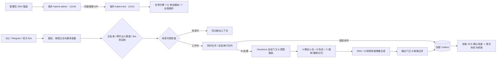

# 哈基米跨平台冲浪助手（Hakimi Surf）

**当前版本：v2.1.0** · 基于 Python 3.12+ 与 FastAPI 的跨平台 AI 伴随与自主冲浪后端，采用「最小内核 + 万物皆模块」架构：支持 **QQ（OneBot v11 / 官方 QQ Bot）**、**Telegram（独立远程插件）**、**B 站冲浪巡逻与看片**、**Minecraft 三层游玩大脑**、**实时天气观测**、**实时语音伴随（Voice Gateway）**、**桌面屏幕伴看（Screen Watch）**、**歌单工坊（双引擎 SVC/RVC 翻唱 + Drive 主存）**与 **Colab 通用 GPU 算力调度**，并通过 7 个只读进程外远程插件容器（`plugin_bus`）收紧重依赖与出网边界。后端默认对接 Gemini `Interactions` 与 `Decisions`（支持 Vertex 优先与 Developer API 回退）。

设计目标很直接：**在群里像个懂分寸的活人损友，在私聊只偏心真正的主人；跨平台记性好、能听语音、会贴表情回戳、能打 MC / 逛 B 站 / 翻唱点歌，同时把注入和越权操作关在服务端确定性裁决边界内。**

> 如果想直观查看全链路模块关系，可以直接下载或浏览器打开离线 [可视化项目架构图 (architecture.html)](architecture.html)。

---

## 核心能力一览

| 模块 | 能做什么 | 默认保护边界 |
| :--- | :--- | :--- |
| **QQ 与 Telegram 跨平台社交** | 白名单群内支持点名搭话与“智能自由插话”；QQ 支持 **贴表情（`emoji_like`）**、**戳一戳（`poke`）**、**原生语音直传 Gemini** 与发表情包；Telegram 远程插件全对等支持图片/贴纸（`.webp` 自动走 `sendSticker`）、原声语音直传、文档、`delivery.send_media` / `delivery.react` / `delivery.typing`、`BaseModule.channel_prompt()` 与 `/admin/api/social-chat/{platform}/config` 实时热配置 | 群聊与普通私聊统一使用公开人设，绝不读取主人私聊记忆；Owner 身份严格锁定协议层 `OWNER_QQ_ID` 与 `HAKIMI_SOCIAL_OWNER_BINDINGS`；外部 Bot 默认 0.85 高门槛防互刷（1.00 为 0 Token 完全屏蔽）；「小黑屋」支持 QQ 与 `<platform>:<user_id>` 统一屏蔽/解封 |
| **高清看图、富文档解析与卡片排版（`doc_render`）** | 支持拉取当前、引用与紧邻群图（默认 16 MiB / 50 MP，超长图双切片）；经独立只读重渲染容器 `doc_render` 支持 `.log`/`.py`/`.json`/`.yaml` 及 **PDF / DOCX / XLSX** 纯内存解析与多行代码块/Markdown 表格高清排版卡片图（容器离线平滑回退内核） | 禁止路径读取，防 Zip/XXE/FlateDecode 炸弹与画布像素硬顶；拒绝 `.env`/内网 SSRF；卡片模式与文件配额均可在 `/admin` 热调 |
| **自主表情库、统一身份与好感度** | 聊天收到好图或 `/存表情` 请求时可自主收录本地表情包；统一身份中心（`identity` + `/bind` 验证码）跨平台合并多端账号与好感度（Lv.0–Lv.6，全天下唯一 Owner 恒定 Lv.6）；与真实 Owner 对话合意时可自动更新 QQ 个性签名 | 最多 100 张本地无元数据 JPEG；非 Owner 封顶 100 分且严禁查询或泄露分值；`Identity ↔ Affection` 跨表原子合并且自动联动小黑屋 |
| **双轨记忆、巡逻日记与加密备份** | 每会话独立加密 SQLite（超过 **14,000 Token** 自动折半，半价 Flex 提炼画像与编年史，遇 Flex 503/429 自动退避重试）；`memory_hub` 统一召回跨会话上下文；`patrol_diary` 本地记录巡逻日记并按授权同步 Drive；主库与 `sessions/` 均支持周期保留清理、`wal_checkpoint(TRUNCATE)` 与加密压缩归档备份 | 会话库物理隔离，私聊记忆绝不渗入公开群聊；对个人云端 `Antigravity_Memory` 目录保持严格只读禁写隔离 |
| **B 站冲浪巡逻与原片看片** | 群聊与私聊分享 B 站视频均可读字幕或原片摘要；`bilibili_surf` 远程插件独占小号 Cookie/冷却并支持委派境内节点采集，结合兴趣记忆自主选片 | 无字幕或需画面细节时走受限原片分析（兼容横/竖屏 ≤540p、默认 **≤900s（15 分钟）**、≤80 MiB，支持境内 `videoshot` 兜底），**本地预检失败不扣每日次数** |
| **歌单工坊、独立找歌与 Colab GPU 算力** | `song_studio` 经 `SongDriveStore` 直连 Google Drive `Hakimi_Songs/` 主存（2 MiB 分块 Resumable 流式上传 ≤100 MiB，30 MiB LRU 热缓存）；`song_finder`（境内只读容器，匿名 `spi` 零账号 Cookie）找歌入收件箱；宿主机 `hakimi-colab-worker.service` 执行默认 `dual` 双引擎 SVC（单次 `BS-RoFormer` 分轨产 `YingMusic-SVC` + `Seed-VC`，保留 `RVC`）并由猫猫主模型原声盲测自选，支持多版本热切播 | Colab ADC 凭据与 CLI 严禁进入只读容器；仅经 `pre_dispatch` 注入瞬态短效 `dispatch_context`；`song_finder` 与 `bilibili_surf` 物理隔离；支持协作取消、60s TTL 状态缓存与 Drive 第三级权重缓存 |
| **Minecraft 三层大脑与实时天气** | 境内第 0 层 `mc_agent`（0 Token 生存、筹料合成、烧炼、安全防拆家寻路、掩体与护卫）+ 境外第 1 层 `gemini-decision-1` 巡航门控 + 第 2 层主模型 `mc.play`（路标 KV、`active_plan` 与 30 步动作流水），配合 `mc-powerd` 按需启停；`weather` 插件提供 Open-Meteo 实时天气观测 | 全链路白名单动作原语，绝不现场 `eval` 任意脚本；B 站观看灵感可通过 `event_rules` 自动登记 `mc.build_plan` |
| **语音伴随（Voice Gateway）与屏幕伴看** | `voice_gateway` 提供多厂商可热切 STT/TTS（Fish / BreezeBlue / SiliconFlow / OpenAI / Edge）与低延迟流式语音伴随会话；`screen_watch` 缓存桌面关键帧供语音通话联动或独立点评 | 语音网关支持引用计数 `ProviderBundle` 防热重载断流；仅认证适配端与受控隐私开关可访问屏幕帧 |
| **免费联网 + DeepSeek 自动降级** | 群聊自然接话、模型自主单次查证与 `/搜索` 均支持经 `web_tools` 容器联网核实；Google Search 瞬态错误自动重试并可降级 DeepSeek 独立记账（前 **5,000 次/月**走 Google Search，不计入 `/admin` 主模型余额扣账） | 公网 IP 钉死与逐跳重定向 SSRF 拦截；绝不导出私人记忆与会话历史；API Key 使用 `Fernet` 加密存 SQLite |
| **世界引擎、作息与云资源账本** | 统一世界时钟、精力/无聊度/白天分段小憩与 `LifeBlockPlanner` 日程规划；通过 `social_presence`（`social.speak`）统一管理跨平台主动发言与 Owner 日报；`gcp_billing` 与 Colab CU 聚合为统一云资源视图 | 每日休眠时段（默认北京时间 **23:00–08:00**）与“主人私聊照常响应”可在 `/admin` 一键热调；所有付费调用按预算池预留并微美元结算 |

---

## 三步快速部署

### 1. 准备配置文件
```bash
cd /root/Document/hakimi-surf
python3 scripts/init_env.py
```
`init_env.py` 会生成 `0600` 权限的安全 `.env`（若已存在则拒绝覆盖，防止误覆密钥）。编辑 `.env`，至少填入：
- `HAKIMI_GEMINI_API_KEY`（Gemini API Key，或配置 Vertex 凭据）
- `ONEBOT_SELF_ID`（机器人 QQ 号）及对应 OneBot / QQ Bot 鉴权凭证
- `OWNER_QQ_ID`（唯一真实主人的 QQ 号；如需绑定 Telegram 等跨平台 Owner，一并配置 `HAKIMI_SOCIAL_OWNER_BINDINGS`）
- `ADMIN_TOKEN`（进入 `/admin` 控制台的管理员口令）

> **⚠️ 请务必备份 `.env` 中的 `HAKIMI_ENCRYPTION_KEY`**。数据库、记忆文件与加密配置全部使用该密钥加密；一旦丢失或擅自更换，旧数据将无法解密启动。

### 2. Docker 一键部署（推荐）
首次部署核心引擎与独立管理台：
```bash
docker compose -f compose.yaml up -d --build
curl --noproxy '*' --fail http://127.0.0.1:12141/healthz
curl --noproxy '*' --fail http://127.0.0.1:12143/healthz
```

按需部署 7 个进程外远程插件容器（先在 `/admin`「插件总线」签发 Token 并写入 `secrets/plugins.env`）：
```bash
# 默认构建并启动全部 7 个插件（weather / minecraft / bilibili / web_tools / doc_render / song_finder / telegram）
bash scripts/deploy_plugins.sh up
# 或仅更新指定插件（替换前自动为旧镜像打 :rollback 标签并校验容器健康运行）
bash scripts/deploy_plugins.sh up telegram minecraft
```

提交日常改动后运行核心发布脚本。它按服务改动自动判断发布对象，先部署并验活 `hakimi-bot`（含 `smoke_container.py` + `/healthz`）再部署 `hakimi-admin`，并为更新的服务保留 `:rollback` 回滚镜像：
```bash
bash scripts/deploy_prod.sh          # 自动按改动发布
bash scripts/deploy_prod.sh engine   # 仅发布引擎 hakimi-bot
bash scripts/deploy_prod.sh admin    # 仅发布管理台 hakimi-admin（引擎不断线）
```

<details>
<summary>本机开发启动 &amp; 跨境（境内节点 + 境外主脑）推荐拓扑说明</summary>

**单独启动引擎进行本机开发（需要 Python 3.12+ 与 `uv`）。联调管理页面时使用上面的双服务 Compose**：
```bash
uv sync --frozen
uv run uvicorn hakimi.app:create_app --factory \
  --host 127.0.0.1 --port 12141 --workers 1 --no-access-log --no-proxy-headers \
  --ws websockets-sansio --ws-max-size 16777216 --ws-max-queue 2 \
  --ws-ping-interval 25 --ws-ping-timeout 30 --ws-per-message-deflate false
```
> 必须保持 **1 个 Uvicorn worker**：进程内维护了会话串行调度、WS 连接状态与事务锁定，不能靠加 worker 水平扩展。

**跨境反向 WSS 拓扑**：
- **境内独立节点仓库**：NapCat（`FireOpalus/hakimi-napcat`）、执行节点代理（`FireOpalus/hakimi-node-agent`）、MC 第 0 层侧车（`FireOpalus/hakimi-mc-agent`）、MC 服务端运维（`FireOpalus/hakimi-mc-server`）与境内 `song_finder`（`plugins/song_finder/deploy-cn/`）均独立部署运行；NapCat `network.websocketClients` 指向 `wss://你的域名/ws/onebot/<随机后缀>`，消息格式选 Array，开启 `enableLocalFile2Url`，25s 心跳 / 5s 重连。
- **境外主脑（Hakimi）**：引擎与管理台分别监听回环端口 `12141`、`12143`，宿主机可选挂载 `hakimi-colab-worker.service`（仅监听 Docker 网桥回环 `172.19.0.1:12146`）与 `hakimi-voice-gateway`（`127.0.0.1:12145`）。公网 Nginx 精确放行 OneBot、境内节点与锁定插件 WSS 路径，其余路径统一 404（模板见 [deploy/hakimi-ws.conf](deploy/hakimi-ws.conf)）；管理后台永不暴露公网。详见 [跨境部署说明](docs/CROSS_BORDER_DEPLOYMENT.md)。

</details>

---

## 聊天指令速查表

> 所有管理与权限指令均由服务端验签并代码裁决，不经过大模型，也不能通过群名、昵称或 Prompt 注入假冒授权。

### 日常互动与看片（白名单群 & 获准私聊）
| 输入 | 作用 | 说明 |
| :--- | :--- | :--- |
| `@机器人` / 叫名字 / 回复机器人的消息 | 正常对话、看图、听语音、贴表情/回戳 | 连续多条气泡会在防抖窗口内合并回复；支持纯贴表情/回戳不刷屏 |
| BV 号 / `bilibili.com/video/BV…` / `b23.tv` / B 站卡片 | 总结视频内容 | 白名单群内正常互动与私聊均可触发读取字幕与原片摘要（默认 ≤900s） |
| `/搜索 <问题>` 或 `/search <问题>` | 显式联网检索 | 需先在后台启用联网搜索；群内自由接话和私聊均可在需要时自动检索，不计入主账单余额 |
| `/哈基米 帮助` | 查看帮助说明 | 纯本地输出，0 Token 消耗 |
| `/new-session` | 清空当前上下文热史 | 不改变记忆开启/关闭状态；群内仅 Owner 可执行 |
| `/哈基米 记忆 开` / `记忆 关` / `清空` | 开关或彻底清除记忆 | 群内仅 Owner 可操作，私聊好友可管理自己的独立会话 |
| `/bind` | 跨平台账号绑定 | 生成或兑换一次性 8 位绑定码（300s TTL）合并多端身份 |

### Owner 专属管理指令（仅协议层已验签 Owner 可用）
| 输入 | 作用 | 使用范围 |
| :--- | :--- | :--- |
| `/存表情 <标签>`（或 `/偷表情`） | 把当前附图或**引用到的群友图片/表情包**一键存入表情库（1～24 字标签） | **私聊 & 群内**（即使 `at_only` 群未 @ 也可引用触发） |
| `/学歌 <歌名>` / `/learn-song <歌名>` | 发起独立找歌或使用附件提交双引擎 SVC/RVC 翻唱学歌作业 | 仅 Owner 私聊 |
| `/换歌版本 <歌名> <版本>` | 切换已存档曲目的默认播放版本（如 `yingmusic_svc` / `seed_vc` / `rvc`） | 仅 Owner 私聊 |
| `/deep <问题或 B 站链接>` | 强制本轮使用最高思考档位深入回答 | 仅 Owner 私聊 |
| `/哈基米 状态` | 查看今日全局预算花费与预留额度 | 仅 Owner 私聊 |
| `/哈基米 订阅 <UP主UID>` / `退订 <UID>` | 订阅或退订 UP 主更新巡逻 | 仅 Owner 私聊 |
| `/哈基米 订阅列表` / `报告` | 查看已订阅 UP 主与最近 7 天巡逻摘要 | 仅 Owner 私聊 |
| `/mute <QQ 或 平台:账号>` / `/unmute <QQ 或 平台:账号>` | 将指定 QQ 或跨平台账号（如 `telegram:123456`）加入或移出小黑屋（QQ 可加 `--delete-friend`） | 仅 Owner 私聊 |
| `/mute-approve <编号>` / `/mute-reject <编号>` | 审批多次触发风控群友的屏蔽提案 | 仅 Owner 私聊 |
| `/set-sign <签名>` | 手动更新机器人 QQ 个性签名（≤50 字纯文本） | 仅 Owner 私聊 |
| `/bot-interact <话题>` | 在群内显式允许本机与 `@` 到的外部 Bot 互动（限时 10 分钟 / 2 轮） | 真实 Owner 在获准群内 |

---

## Web 管理台（`/admin`）

页面、样式、脚本和内容安全策略由 `admin/src/` 经 `admin/build.py` 组装为单文件 `admin/admin_page.html`，在构建 `hakimi-admin` 镜像时预压缩为 `admin_page.html.gz` 并启用 `gzip_static on;`（严格保留 `Cache-Control: no-store` 与逐块 SHA-256 CSP）。保存设置和触发任务时，后台把同源请求交给引擎的 `/admin/api/*`（其中 `/admin/api/songs/inbox`、`/upload` 放行 100 MiB、`/ref-voices` 放行 25 MiB 无缓冲直传）。

独立管理台 `hakimi-admin` 只映射服务器回环地址 `127.0.0.1:12143`，在本地电脑建立 SSH 隧道后打开浏览器访问 `http://127.0.0.1:12141/admin`：

```bash
ssh -N -L 127.0.0.1:12141:127.0.0.1:12143 你的用户名@服务器IP
```

后台做出的绝大部分修改都会加密保存在 SQLite 中，**无需重启立即生效**，并可一键恢复回 `.env` 初始值：
- **运行总览与统一云资源视图**：实时查看各业务维度（`usage.categories`）用量与前缀缓存命中率，聚合展示 GCP 账单赠金对账、Colab CU 14/30 日趋势与热保活会话；
- **世界引擎与社交排程**：管理夜间休眠、白天小憩、共享 `SocialScheduleOptions`（`social_presence`）、跨平台 Owner 投递、MC 三层大脑控制与 30 步动作流水、跨日待办账本（`event_ledger`）；
- **模型、思考档位与联网**：全局切换 Hydrogen / Neon / Carbon 主模型与各插件声明的思考场景；查看 Google Search 月用量与 DeepSeek 加密备用配置；
- **跨平台准入、身份与社区治理**：支持 QQ 与 Telegram 群策略标签及 Telegram 实时热配置（群白名单、主动冒泡、私聊白名单、群记忆镜像）；管理统一身份档案、7 阶好感度、跨平台「讨厌鬼小黑屋」与待审批告状；
- **歌单工坊、表情库与伴随服务**：异步非阻塞加载 Drive 歌单收件箱/参考干声/多版本候选试听与切播；批量拖拽上传表情包；热切换 Voice Gateway STT/TTS 并在线试听；管理 7 个远程插件凭据与一次性 Token。

**群聊称呼分两档。** 在已放行的群里，正文中的「吉米奈喵、吉米奈、杰米奈喵、杰米奈、哈基米、大小姐」属于明确点名，跳过插话分数。「小小姐、猫猫、猫猫小姐、Gemini」属于可能称呼，英文大小写均可。门控结合最近群聊区分「猫猫，你在吗？」这样的呼唤和「我家猫猫睡着了」这样的闲聊。仅点名模式也会评估可能称呼，静默群保持静默。两档均须通过安全审核，只识别群友自己输入的正文。

---

## 进阶配置与日常维护

### 巡逻日记与模块文件同步

在「功能模块 → 巡逻日记」按日期预览本地 Markdown 和日记投递记录。「功能模块 → Google Drive 同步」按调用模块展示同步用途、最近尝试、最近成功和失败原因。每天 23:55 生成当日总结，离线后可补办，手动汇总复用同一天的付费尝试。「模型与思考 → 巡逻日记」管理总结档位。

Drive 凭据与隔离文件夹配置齐全后，每两小时及当日收尾同步有变化的日记。缺少配置时照常生成本地日记。授权失效或网络错误会记录失败原因并按退避时间重试，上传任务直接读取本地内容。

- 支持 **Service Account**（需把 Shared Drive 指定子文件夹分享给服务账号，对应 `compose.roaming.yaml`）或 **个人网盘 OAuth**（通过 `ssh -L 12142` 运行 `.venv/bin/python scripts/authorize_drive.py` 引导授权，只申请受限 `drive.file` 权限，对应 `compose.roaming-oauth.yaml`）。
- 既有 `HAKIMI_ROAMING_ENABLED` 继续作为敏感归档授权，亦可用 `HAKIMI_ARCHIVE_AUTHORIZED_DATA` 配置。授权涵盖白名单聊天原文及原有 Owner 镜像和备份导出。默认只整理公开材料和群活动计数。Owner 日报单独选择标注为公开的巡逻摘要、世界事件和群活动计数。私聊原文、未标明来源的旧报告均不会进入日报输入。群记忆的 Drive 同步仍按群控制。

### 在管理台核对世界引擎

- 在「世界引擎 → 世界作息与调度」设置入睡、起床时间和 Owner 私聊例外。定时睡眠每 4 分钟恢复 1 点精力。白天由哈基米参考当前精力和无聊度，自主选择活动、清醒空闲或小憩。小憩前 10 分钟每 1 分钟恢复 1 点精力，10–30 分钟每 2 分钟恢复 1 点，30 分钟后每 6 分钟恢复 1 点（每日最多 2 次、冷却 3 小时、入睡前 2 小时不再小憩），可同时安排醒来后的活动，并为当日日报预留时间。
- **今日行程**随 Bot 的本地日期更新。启用定时睡眠时，起床即做一次全日规划。关闭定时睡眠时，每个本地自然日从零点开始可规划。晨间规划默认用 `medium`，在「模型与思考 → 世界引擎与公共服务」可选 `high`。
- 「模型与思考」按插件声明装载场景。Hydrogen 和 Neon 支持到 `xhigh`，Carbon 支持到 `high`。单独切换主模型会保留之前的场景偏好，后台只列出当前模型及场景支持的档位。[Google 思考档位说明](https://aistudio.google.com/docs/thinking#thinking-levels)
- **七日观测与回执**：管理台按实际运行日记录规划次数、本地省下的付费规划调用和下次行动；跨平台日报与主动发言记录生成、入队及平台确认回执时间。

### 常用维护与验证命令
```bash
# 查看汇总运行状态（可直接在宿主机进入容器或本机 venv 执行）
docker compose -f compose.yaml exec hakimi-bot python -m hakimi.admin status

# 若因实际用量异常超出预留触发了「预算熔断」，核对上游账单无误后可手工解除：
docker compose -f compose.yaml stop hakimi-bot
docker compose -f compose.yaml run --rm hakimi-bot python -m hakimi.admin clear-budget-circuit
docker compose -f compose.yaml up -d

# 本机静态检查、管理台构建/CSP 审计与全量并行测试（全模拟 Mock，不产生真实 API 计费）
.venv/bin/ruff check .
.venv/bin/ruff format --check .
.venv/bin/python admin/build.py --check --verify-file
.venv/bin/python admin/csp.py
bash scripts/test_fast.sh -q
```

---

## 系统架构与安全隐私底座

### 主动动作、扩展模块与远程插件 · v2.1.0

生活引擎按注册的动作名调度。B 站每学完一个视频产生一条观看事实，建造灵感规则可据此创建内部 `mc.build_plan`。境内确认后记录“已登记计划”。重要进展由内核平台中立规则 `social.milestone` 起一张 `social.speak` 票据（兼容 `qq.speak`），发送前重新检查目标平台连接、白名单、共享 `SocialScheduleOptions`、预算、免打扰与会话状态。

| 层级 | 组成 | 职责边界 |
| :--- | :--- | :--- |
| **4 个平台子模块 + 内置 `social_presence`** | `qq`、`bilibili`、`minecraft`、`weather`（独立子模块仓）+ `social_presence`（内核内置 `BaseModule`） | 声明 `actions()`、`schedules()`、`event_rules()`、`thinking_scenes` 与 `ScheduleOptions`，后台自动生成配置与调度 UI |
| **21 个常驻系统模块** | `drive_sync`、`patrol_diary`、`database_backup`、`group_memory_mirror`、`surf_mirror`、`owner_notebook`、`event_ledger`、`identity`、`affection`、`memory_hub`、`memory_compressor`、`plugin_bus`、`proactive_delivery`、`screen_watch`、`voice_gateway`、`voice_companion`、`colab_compute`、`song_studio`、`gcp_billing`、`video_watch`、`meme_library` | 启动时按 `requires` 拓扑加载，提供记忆、身份、好感、事件账本、云算力、曲库、伴看、语音、账单与插件总线底座 |
| **7 个只读远程插件容器** | `weather`、`minecraft`、`bilibili_surf`、`web_tools`、`doc_render`、`song_finder`、`telegram`（`compose.plugins.yaml`） | 独立容器零宿主机卷、非 root、`cpus` 限额、`/proc` 健康检查；通过 `plugin_bus` 控制面 + 双向分块 Blob 总线与主引擎协作 |

### 模块仓库与检出
各平台模块各有自己的 Git 仓库。主仓固定目录仓库（`FireOpalus/hakimi-modules`）提交，目录的 `.gitmodules` 列出已安装模块。

| 模块 | 独立仓库 | 主仓检出路径 |
| --- | --- | --- |
| QQ 社交 | [hakimi-module-qq](https://github.com/FireOpalus/hakimi-module-qq) | `src/hakimi/modules/platforms/qq/` |
| B 站巡逻 | [hakimi-module-bilibili](https://github.com/FireOpalus/hakimi-module-bilibili) | `src/hakimi/modules/platforms/bilibili/` |
| Minecraft | [hakimi-module-minecraft](https://github.com/FireOpalus/hakimi-module-minecraft) | `src/hakimi/modules/platforms/minecraft/` |
| 天气观测 | [hakimi-module-weather](https://github.com/FireOpalus/hakimi-module-weather) | `src/hakimi/modules/platforms/weather/` |

```sh
git clone --recurse-submodules https://github.com/FireOpalus/hakimi-surf.git
# 已有检出，更新主仓后同步到各自指定的版本
git submodule update --init --recursive
```

### 跨平台社交接入与 Owner 绑定
社交插件在 `chat_platforms` 声明协议名，通过 `service.accept_from(module, message)`（或远程 `plugin_bus` `chat.inbound`）提交消息。会话键包含部署命名空间、平台、机器人账号、会话类型和会话 ID。`HAKIMI_SOCIAL_OWNER_BINDINGS` 按协议配置已验证的 `bot_id`、`user_id` 及可选 `notebook`/`mirror` 授权（默认关闭）；`HAKIMI_OWNER_DELIVERY_PLATFORM` 选择 Owner 日报与主动提醒投递平台。[社交插件契约](src/hakimi/modules/README.md) · [离线验证](tests/test_social_plugins.py)

### 消息处理全链路


<details>
<summary>核心源码目录速览 &amp; 底层安全边界铁律</summary>

| 目录 / 文件 | 核心职责 |
| :--- | :--- |
| `src/hakimi/app.py` / `service.py` / `service_turn.py` / `service_delivery.py` | FastAPI 入口、Webhook/WS 鉴权、会话串行编排、事件驱动出站投递与 ACK 回执 |
| `src/hakimi/social.py` / `social_presence.py` / `social_chat_config.py` / `platform_hooks.py` | 跨平台寻址与 Owner 判定、统一主动发言 `social.speak`、远程社交热配置与未知平台 fail-closed 策略钩子 |
| `src/hakimi/commands.py` / `moderation.py` / `identity.py` / `affection.py` | 协议层确定性指令路由、跨平台小黑屋与告状审批、统一身份 `/bind` 合并及 7 阶好感度权限门控 |
| `src/hakimi/gemini.py` / `gemini_generate.py` / `provider_routing.py` / `gateway.py` | `Decisions` 安全/接话门卫、Hydrogen / Neon / Carbon 流式生成、Vertex/Developer 双通道与续链 |
| `src/hakimi/session_manager.py` / `dual_memory.py` / `memory_hub.py` / `memory_compressor.py` | 分会话加密库（只读零锁路径）、14k 折半归档、Hydrogen Flex 双轨提炼与统一记忆中枢 |
| `src/hakimi/media.py` / `media_turn.py` / `audio_media.py` / `memes.py` / `file_reader.py` / `text_card.py` | 图片高清缩放切片、QQ/TG 语音 16 kHz MP3 转码直传 Gemini、本地表情包库及富文档/卡片渲染回退 |
| `src/hakimi/songs.py` / `song_drive.py` / `colab_compute.py` / `scripts/colab_*` | 歌单工坊（双引擎 SVC/RVC 多版本切播、猫猫原声亲听）、独立 Drive 主存与宿主机 Colab GPU Worker |
| `src/hakimi/voice_companion.py` / `screen_watch.py` / `voice_gateway/` / `voice_client/` | 实时语音伴随会话、可热切多厂商 STT/TTS 网关与桌面看屏/语音伴随端 |
| `src/hakimi/life_engine.py` / `world_state.py` / `event_ledger.py` / `life_rules.py` | 世界时钟/精力节律、`LifeBlockPlanner`、跨日待办账本与跨模块事件规则分发 |
| `src/hakimi/plugin_bus/` / `src/hakimi_plugin_sdk/` / `plugins/` | 无环分层远程插件 WS + 双向分块 Blob 总线、插件 SDK 与 7 个只读进程外插件容器 |
| `src/hakimi/system_modules/` / `src/hakimi/modules/` | 21 个常驻系统模块与可插拔平台模块注册表（4 个独立子模块仓） |
| `src/hakimi/store.py` / `db_backup.py` / `gcp_billing.py` / `*_admin.py` / `admin/` | Fernet 加密持久化、主库与 `sessions/` 压缩备份、GCP 账单对账、管理 API 与零依赖编译前端（`admin/src/` + `admin/build.py`） |

**确定性安全底座**：
1. **双门卫隔离**：所有不可信群聊消息、外部网页、视频字幕均以纯 JSON 数据传入，先过 `Decisions` 注入/违规打分，输出再二次复检。
2. **零危险工具**：大模型无 Shell、无文件读写、无任意发包权限，联网与重解析外置至只读受限容器。
3. **落盘加密与不留原文日志**：任务队列、Outbox 正文、对话热史、人物画像与配置均绑定上下文 Fernet 加密；不打印聊天正文、URL 签名与凭证；`Antigravity_Memory` 严格只读禁写。
4. **防 SSRF 与严格边界**：图片/网页/视频/音频下载全部固定公网 DNS、严禁内网 IP、限制响应体积与编码解压大小；所有调用先在 SQLite 事务内按最坏上界预留微美元额度，不超出日/月上限。

</details>

### 专题深度文档导航
- 架构与记忆：[可视化架构图](architecture.html) · [双轨记忆与治理 (MEMORY_100)](docs/MEMORY_100.md) · [上下文与休息门禁 (CONTEXT_REST_130)](docs/CONTEXT_REST_130.md)
- 图像与多媒体：[图片缩放与双切片 (IMAGE_QUALITY_131)](docs/IMAGE_QUALITY_131.md) · [图片上下文追踪 (IMAGE_CONTEXT_120)](docs/IMAGE_CONTEXT_120.md) · [B 站字幕与原片看片 (VIDEO_WATCH)](docs/VIDEO_WATCH.md)
- 社交与安全机制：[核心管道与续链 (CORE_PIPELINE_08)](docs/CORE_PIPELINE_08.md) · [过滤、防抖与流式出站 (STREAMING_010)](docs/STREAMING_010.md) · [人设与 Bot 防互刷 (PERSONA_AND_BOT_GUARD)](docs/PERSONA_AND_BOT_GUARD.md) · [费用账本与结算 (BILLING_118)](docs/BILLING_118.md)
- 运维与部署：[跨境部署说明 (CROSS_BORDER_DEPLOYMENT)](docs/CROSS_BORDER_DEPLOYMENT.md) · [升级交付说明 (UPGRADE)](docs/UPGRADE.md) · [管理台说明 (ADMIN_AND_MEMORY)](docs/ADMIN_AND_MEMORY.md)
