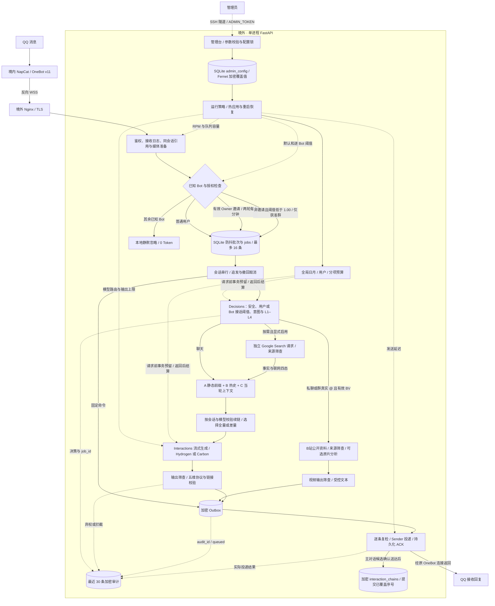

# 哈基米跨平台冲浪助手

当前版本 **1.1.7**。已知外部 Bot 新增默认／逐账号接话阈值，`1.00` 完全屏蔽，较低阈值须经 Decisions；冷历史支持同会话合批、提炼前双重预算预检与逐条事实校验，详见 [1.1.7 升级说明](docs/BOT_MEMORY_117.md)。沿用 [1.1.6 热配置与星夜控制台](docs/CONTROL_PLANE_116.md)、[1.1.5 执行审计](docs/DELIVERY_AUDIT_115.md) 与 [1.1.4 差量续链](docs/GROUP_CONTEXT_114.md)。防抖仍支持 **0–30 秒**；后台设置加密保存并热生效；联网默认关闭。

保留 1.0 的 [双轨记忆与治理说明](docs/MEMORY_100.md)：每个会话的加密 SQLite 增建画像、编年史、不可变冷史，后台通过 Hydrogen Flex 半价提炼，在线按需本地召回；管理台可检索、修订、擦除及解锁，显式选择的白名单群可与单目录 Drive Markdown 双向同步。旧摘要保留至首次成功提炼。私聊档案不导出，Owner《小本本》仍默认关闭。

沿用 [v0.10 流式防抖与五维出站](docs/STREAMING_010.md) 和 [v0.9 A/B/C 前缀路由](docs/CONTEXT_ROUTING_09.md)。群聊／Owner 私聊默认 `auto`，后台可选至 `xhigh`；双轨归档固定 `medium`。三段原文人设、跨机 WS 和账本安全边界不变；新增 `memory_flex` 费用列。有效缓存覆盖率 90% 是观察目标，不能保证每次命中。

[项目架构图（HTML/CSS）](architecture.html)：按 **1.1.7 当前源码**重构，区分消息数据流、热配置控制流与后台归档流程，增加 Bot 三路分流、冷历史合批与预算预检图；保留跨机部署、审计、差量续链与隔离存储。下载或克隆后可离线打开，支持窄屏、深浅主题及源码跳转。下方「实现结构」提供可在 GitHub 直接查看的简图。

0.8.0 新增 [会话串行管道、引用回溯与受控点名](docs/CORE_PIPELINE_08.md)，支持 [上海 NapCat／首尔主脑分离部署](docs/CROSS_BORDER_DEPLOYMENT.md)。群聊、私聊与 `@Bot` 统一先写隔离接收日志，再按 1.8 秒／最长 3.5 秒防抖；同会话模型请求串行，后台清空通过 epoch 作废旧任务。补齐引用／转发原图、公开群互动到 Owner 私聊的单向背景、受控 `[AT:...]` 与本地表情联合发送。预算日／月边界统一按 `BOT_TIMEZONE=Asia/Shanghai`，旧 UTC 账本保留审计并保守迁移。

默认双端拓扑：上海只运行 NapCat，首尔只运行后端；公网只开放 `qq.example.com` 的随机后缀 WS 路径，原主域名 DSH 站点保留。管理台仅经 SSH 隧道访问回环 **12141**。下方旧版本段落是功能沿革，当前行为以 1.0 记忆文档及 0.10 管道文档为准。

0.7.0 新增 [群聊防抖、看图与本地表情包](docs/GROUP_SOCIAL_AND_MEMES.md)：明确 `@他人` 时先做 0 Token 抢话过滤，同群消息默认按 1.8 秒窗口合并、最长等待 3.5 秒；结合当前批次与紧邻三条群消息安全看图。公开人设改为平视群友的短句口语，Owner 私聊与共享指令保持原文。`/admin` 可管理本地表情白名单，通过 `base64://` 跨容器发送；B 站小号缺失 `buvid4` 时可按需补齐并加密持久化。

0.6.1 更新 [原文人设与群／私聊准入隔离](docs/PERSONA_AND_ADMISSION.md)：共享 `SYSTEM_INSTRUCTION` 放在最前，三段提示词采用用户原文；白名单群内所有非黑名单成员按群策略互动，不再受私聊好友名单或旧 `HAKIMI_ALLOW_GROUP_MEMBERS` 限制。聊天管理指令与 Owner 专属权限仅认真实 OneBot `OWNER_QQ_ID`。

0.6.0 新增 [低误杀网关、过滤审计与日／月预算](docs/FILTERING_AND_BUDGETS.md)：明确点名跳过插话筛选，群自由插话参考近期上下文；后台热调消息阈值和群活跃度，展示缓存／思考 Token、缓存命中率及两种费用口径。日预算与 UTC 自然月预算支持持久化热调整。

面向 Linux 服务器的 Python 3.12+ 异步后端；后端仍是单实例，协议端可独立部署在上海。支持 OneBot v11 HTTP、NapCat 正向／反向 WebSocket，以及官方 QQ Bot 的私聊、群 @ Webhook。B 站功能支持公开视频链接摘要、UP 主巡逻，以及默认关闭的独立小号文本巡逻。

默认策略：OneBot 私聊仅 Owner、白名单群内所有非黑名单成员可按群策略互动（默认仅明确叫到时回复）、每会话独立保存双轨记忆、加密冷史与热消息（可关闭）、每日总预算 2 美元、默认主对话无工具权限；显式开启的独立联网请求仅使用 Google Search。适合个人与小群；一个实例只绑定一个 OneBot 账号和一个 QQ AppID。

0.5.0 新增 [字幕优先与受限原片分析](docs/VIDEO_WATCH.md)。群／私聊的视频卡片链接和小号自主巡逻共享原片额度；默认关闭，开启后无可用字幕或明确要求视听细节才用 yt-dlp 下载低清 MP4，经 Files API、视频 Decisions 和 Interactions 分析。默认最长 480 秒、每天 3 次尝试、每文件最多 80 MiB。

0.4.0 新增 [准入名单、小黑屋与受控个签](docs/ADMISSION_AND_LIFE.md) 和 [B 站小号巡逻](docs/BILI_ACCOUNT.md)。`/admin` 可热更新群白名单、普通好友准入、外部 Bot 黑名单及审批屏蔽；Owner/self 受底层保护。私聊默认仅 Owner，小号巡逻、自动个签和 B 站写操作均默认关闭。

0.3.1 支持按群聊／私聊热调整压缩阈值，默认端口改为 12141；0.3.0 新增 [内嵌管理台、滚动记忆与只读快照](docs/ADMIN_AND_MEMORY.md)，通过 SSH 隧道访问 `/admin`。0.2.2 加入双层人设、协议身份校验、群聊 Owner 偏心和持久化 Bot 互聊限制，见 [人设与互动保护说明](docs/PERSONA_AND_BOT_GUARD.md)。统一 Hydrogen 分档、`/deep` 和日记总结策略见 [模型策略说明](docs/MODEL_POLICY.md)。

增量升级的文件清单、SQLite 表结构、NapCat 配置、Drive 权限要求与迁移说明见 [升级交付说明](docs/UPGRADE.md)。完整可部署代码位于本目录；运行 `python3 scripts/package_delivery.py` 可在 `dist/` 生成交付包和逐文件代码汇总，生成产物不纳入 Git。

0.3.2 新增 [Owner 专属主动私信](docs/OWNER_PROACTIVE.md)：0 Token 运维告警、22:30 日报、本地随机陪伴计划、离线队列与发送确认后写入私聊记忆。`/admin` 的「主动私信」面板可持久化修改开关和时段；所有主动发送底层锁定唯一 `OWNER_QQ_ID`。

## 快速启动

本机开发需要 Python 3.12+ 和 uv；下方 Docker 方式无需在宿主机安装 uv。

```bash
cd /root/Document/hakimi-surf
uv sync --frozen
python3 scripts/init_env.py
# 编辑 .env：填自己的 Gemini API Key、机器人 ID、主人 ID 和适配器凭证
uv run uvicorn hakimi.app:create_app --factory \
  --host 127.0.0.1 --port 12141 --workers 1 --no-access-log --no-proxy-headers \
  --ws websockets-sansio --ws-max-size 16777216 --ws-max-queue 2 \
  --ws-ping-interval 25 --ws-ping-timeout 30 --ws-per-message-deflate false
```

`init_env.py` 创建权限为 `0600` 的 `.env`，随机生成本地加密密钥、OneBot 签名密钥、HTTP Access Token 和 WS Token；已有 `.env` 时拒绝覆盖。按启用的传输方式把对应 OneBot 凭证配置到 NapCat。密钥不会打印到终端。

API Key 使用 `HAKIMI_GEMINI_API_KEY`，通过 SDK 的 `api_key=` 显式传递。至少启用并配置一个 QQ 适配器。配置缺失、占位符、旧版 SDK 或错误加密密钥均会导致启动失败。

### Linux Docker 部署

完成 `.env` 后：

```bash
docker compose up -d --build
curl --fail http://127.0.0.1:12141/healthz
docker compose logs --tail 30 hakimi-bot
```

首尔 Compose 只运行 `hakimi-bot`，只发布 `127.0.0.1:12141:12141`；上海使用独立 `docker-compose.napcat.yml`，通过公网 WSS 主动连接首尔 Nginx。容器内 localhost 不代表宿主机，也不存在两机共享文件路径。进程以 UID 10001 运行，根文件系统只读、移除 capabilities，并限制内存、CPU、PID 和日志大小。数据位于 `hakimi-data` 命名卷。不要执行会删除数据卷的 `docker compose down -v`。

跨机部署使用 [严格 WS Nginx 模板](deploy/hakimi-ws.conf)：新子域名 `qq.example.com` 只精确代理一条 `ONEBOT_WS_PATH`，其余路径统一 404；不要覆盖原主域名 DSH 配置。模板中的随机路径和证书必须先配置，并用 `nginx -t` 验证。旧 `deploy/nginx.conf` 仅用于另行选择的 Webhook 拓扑，不能与本次“公网仅 WS”策略混用。完整准备和切换步骤见 [跨境部署说明](docs/CROSS_BORDER_DEPLOYMENT.md)。

## QQ 接入

| 项目 | OneBot v11 | 官方 QQ Bot |
| --- | --- | --- |
| 接收路径 | `/webhooks/onebot` 或 `/ws/onebot`；也可主动连接 NapCat | `/webhooks/qq` |
| 入站认证 | HTTP HMAC-SHA1；WS Bearer Token、Self-ID、登录身份核对 | 原始请求体 Ed25519、`X-Signature-Timestamp`、`X-Bot-Appid` |
| 时间／去重 | 已签名事件时间、持久化消息 ID | 签名时间和事件时间、持久化消息 ID |
| 回调确认 | 204，不执行 quick action | `op=12`，`op=13` 独立完成地址验证 |
| 出站认证 | HTTP／WS 握手 `Authorization: Bearer …` | AppSecret 换取 access_token，`Authorization: QQBot …` |
| 支持事件 | 私聊、群消息；数组与 CQ 字符串 | `C2C_MESSAGE_CREATE`、`GROUP_AT_MESSAGE_CREATE` |

OneBot 设置上报地址、`secret`、消息格式及 HTTP API Access Token，确保 `self_id` 与 `.env` 一致。推荐使用 universal 反向 WS 和消息段 Array。支持正向 WS 重连及反向 WS 保活；官方 QQ 频道事件仍不在适配范围。

官方 QQ 在管理端填写 HTTPS 回调地址并订阅上述事件。当前官方 OpenAPI 域名是 `api.bot.qq.com`。回调地址验证按官方协议可以没有签名头，但必须满足受限的 challenge 结构、AppID 和时间检查，且不会进入消息队列。普通事件一律需要签名。

官方 QQ 普通好友私聊须列入 `HAKIMI_QQ_ALLOWED_USERS`，填写该 AppID 下的 **user_openid**；群内是 **member_openid**，群 ID 是 **group_openid**，均不能直接填写 QQ 数字账号。群成员 OpenID 与私聊 OpenID 不自动合并。旧 `HAKIMI_QQ_OWNER_IDS` 仅保留配置兼容，不授予私聊准入、管理或 Owner 权限；机器人业务角色、显示名和模型判断也不能赋予这些权限。

所有白名单使用 JSON 字符串数组，例如 `HAKIMI_ONEBOT_ALLOWED_GROUPS=["12345678"]`。OneBot 私聊默认 `owner_only`；切换为 `owner_and_allowlist` 后，真实 Owner 和 `allowed_users` 内的非黑名单好友可私聊。群聊独立校验 `allowed_groups`：只要群获准，所有非黑名单成员均可按本群策略互动，不要求列入 `allowed_users`。`at_only` 响应真实 @、直接昵称呼唤、核验过的 Bot 引用回复和 B 站链接／卡片；`smart_reply` 另由 Decisions 判断自由插话，`muted` 直接忽略。`HAKIMI_ALLOW_GROUP_MEMBERS` 仅兼容旧配置，其值不再限制白名单群成员。

唯一的 `OWNER_QQ_ID` 同时限定聊天管理身份与专属人设：认证后的 OneBot 事件须匹配本机器人和该 `user_id`；只有对应私聊使用 `OWNER_PERSONA_PROMPT`。所有群聊均使用 `PUBLIC_PERSONA_PROMPT`，公开聊天把 Owner 当熟人损友，不表忠心、不读取私聊历史；真实身份仍供权限和插话门槛判断。昵称和消息内角色标记无效。旧 `HAKIMI_ONEBOT_OWNER_IDS`／`HAKIMI_QQ_OWNER_IDS` 不授予管理或 Owner 权限；官方 QQ OpenID 不映射为数字 QQ 身份，使用公开人设。管理后台继续独立验证 `ADMIN_TOKEN`。

`BOT_QQ_IDS` 标识已知外部机器人。默认 `BOT_REPLY_THRESHOLD=0.85`；在获准群与群策略允许的前提下，未获邀请的 Bot 须通过自身 `should_reply` 门槛，即使 @ 本机也不跳过。设为 `1.00` 可恢复 0 Token 完全屏蔽；逐账号设置优先，私聊 Bot 继续在门口忽略。真实 Owner 的显式邀请使用独立的两轮／10 分钟许可，保留受控 @／引用；阈值接话清除这些锚点，Bot 消息不会自动联网或解析 B 站视频。两轮限制仅作用于邀请路径；阈值路径仍受全局 RPM、队列与预算控制。详见 [Bot 接话路径](architecture.html#bot-routing)。

巡逻订阅、报告和状态等管理命令仅由真实 Owner 在 OneBot 私聊中执行；主动汇报底层固定发往 `OWNER_QQ_ID`。官方 QQ OpenID 不具有这些管理和主动私信权限，旧主动开关也不能绕过接收人校验。发送失败不会自动改发到其他人或群。

### NapCat WebSocket

推荐反向连接：设置 `HAKIMI_ONEBOT_MODE=ws_reverse`、至少 32 字符的 `ONEBOT_ACCESS_TOKEN` 和随机后缀 `ONEBOT_WS_PATH`，关闭不使用的 OneBot Webhook。上海 NapCat 的 `network.websocketClients` 填写 `wss://qq.example.com/ws/onebot/<随机后缀>`、`token`、Array 格式、25 秒心跳和 5 秒重连；顶层开启 `enableLocalFile2Url`。握手必须携带 `X-Self-ID`、`X-Client-Role: Universal`，不支持拆开的 Event/API 双连接。新连接通过认证可接管半开旧连接；完整模板见 [跨境部署说明](docs/CROSS_BORDER_DEPLOYMENT.md)。兼容旧变量 `HAKIMI_ONEBOT_WS_TOKEN`，新变量优先。

正向连接：设置 `HAKIMI_ONEBOT_MODE=ws_forward` 与 `HAKIMI_ONEBOT_WS_URL=ws://127.0.0.1:3001/`，NapCat 开启对应 universal WS 服务端。本服务指数退避重连；反向模式由 NapCat 重连。两种模式都会核对 `get_login_info`，通过 `get_status` 和协议 ping/pong 保活。发送超时仍遵循原来的不自动重发策略。

配置示例：`HAKIMI_GROUP_POLICIES={"onebot:123456":"smart_reply","onebot:654321":"muted"}`。群白名单决定哪些群可以参与，群策略决定如何互动；所有非黑名单成员共享该群策略，私聊名单不参与判断。策略不能绕过 Bot 自回环、外部 Bot 或小黑屋过滤。显式配置覆盖已持久化策略，移除配置项不会自动删除旧策略；要恢复默认请显式设为 `at_only`。

### 隔离巡逻日记

日记支持显式选择两种鉴权方式，均仅请求 `drive.file`，运行时固定一个文件夹。默认 `GDRIVE_AUTH_MODE=service_account`：设置 `GDRIVE_SERVICE_ACCOUNT_FILE`，按 `compose.roaming.yaml` 只读挂载，仅把指定 Shared Drive 子文件夹分享给专用 Service Account，不授予整个共享云端硬盘的成员权限，也不配置域级委派。

默认每两小时及本地时间 23:55 同步 `YYYY-MM-DD.md`。群聊必须单独加入 `HAKIMI_ROAMING_GROUP_IDS`；日记只记脱敏活动类别／次数和通过检查的公开巡逻摘要，不复制群聊原话、图片或私聊记忆。23:55 使用 Hydrogen medium 做一次安全总结；白天上传仍使用模板，结果和尝试状态持久化以避免重复计费。失败在本地保留待同步状态并退避重试；云端日记不自动删除，本地日记事件约保留 8 天。

**Service Account 没有个人 Drive 存储配额，不能拥有新文件。** 该模式仅支持 Shared Drive 子文件夹。个人网盘可以由管理员明确选择下方 OAuth 模式；程序不会在鉴权失败时自动切换身份或扩大权限。[Google 官方说明](https://developers.google.com/workspace/drive/api/guides/handle-errors#storageQuotaExceeded)

#### 个人网盘 OAuth（不需要 Workspace）

1. 在专用 Google Cloud 项目中启用 Google Drive API。在 Google Auth Platform 配置 External 受众，只添加 `https://www.googleapis.com/auth/drive.file`，创建 **Desktop app** 客户端，将下载的 JSON 放到 `secrets/roaming-oauth-client.json`，设为 `0600`。
2. 为长期同步，在 Audience 中把发布状态切换到 **In production** 后再授权。External + Testing 的 Drive 刷新凭证会在 7 天后过期；发布状态并不等于公开服务器端口。个人使用仍可能遇到 Google 的验证提示或账号限制。[OAuth 凭证有效期](https://developers.google.com/identity/protocols/oauth2#expiration)
3. 在本机建立临时隧道：`ssh -N -L 127.0.0.1:12142:127.0.0.1:12142 用户名@服务器`。在服务器项目目录运行 `.venv/bin/python scripts/authorize_drive.py`，在本机浏览器打开它打印的 `AUTH_URL`，选择个人 Google 账号并授权。
4. 引导程序使用 PKCE 和 state，只监听回环地址；不记录授权码。它只创建一个名为「哈基米巡逻日记」的文件夹，将其 ID、应用标记和仅限 `drive.file` 的刷新凭证写入 `secrets/roaming-oauth.json`。中断恢复只检查已预分配的文件夹 ID，不搜索个人网盘，不重复创建文件夹。
5. 设置 `GDRIVE_AUTH_MODE=oauth`、`GDRIVE_ROAMING_FOLDER_ID=<输出的ID>`、`GDRIVE_OAUTH_CREDENTIALS_FILE=/run/secrets/roaming-oauth.json`、`HAKIMI_ROAMING_ENABLED=true`。保留 `ENABLE_NOTEBOOK_SNAPSHOT=false`，清空 `GDRIVE_NOTEBOOK_SNAPSHOT_FILE_ID`。将刷新凭证设为 `chown 10001:10001 secrets/roaming-oauth.json` 和 `chmod 0400 secrets/roaming-oauth.json`。
6. 首尔运行 `docker compose -f docker-compose.yml -f compose.roaming-oauth.yaml up -d --build --no-deps hakimi-bot`；不要再加载旧的本机 NapCat overlay。不要同时加载 Service Account 的 `compose.roaming.yaml`。容器只挂载刷新凭证，客户端原始 JSON 不进入容器或镜像。
7. `/admin` 点击「立即汇总上传今日巡逻日记」，查看当日日记的 `last_success`、`last_error` 和文件 ID；「已尝试同步」本身不代表成功。重复点击内容不变时不重复上传。没有活动时生成真实的空日记模板，不调用 Gemini 编造事件。

`drive.file` 允许访问本应用创建或用户明确授权给应用的文件，并非 Google 提供的单目录 scope。专用项目不复用其他文件授权；服务另外校验凭证绑定的文件夹 ID、文件夹标记、父目录、文件名和写入者标记。小本本不继承日记 OAuth，也不因此启用。[权限范围](https://developers.google.com/workspace/drive/api/guides/api-specific-auth)

授权被撤销或过期时后台显示 `drive_oauth_reauthorization_required`，不会改用其他凭证。使用同一个客户端运行 `scripts/authorize_drive.py --reauthorize`，核验原文件夹后更新凭证，再恢复 `10001:10001 / 0400` 并重建后端容器加载新挂载文件。

## 使用命令

| 输入 | 行为 |
| --- | --- |
| 普通文字 | Decisions 筛查通过后生成中文回答 |
| BV 号或 `https://www.bilibili.com/video/BV…`（多条取首个） | 读取字幕／公开元数据自然摘要（不附免责抬头或重复原链接）；UP 巡逻推送保留新视频链接 |
| `/deep <问题或视频链接>` | 仅 Owner 私聊，本轮使用 Hydrogen high，仍先过 Decisions |
| `/哈基米 帮助` | 显示用法，不调用模型 |
| `/new-session` | 清空当前私聊／本群上下文，保持记忆开关；群内仅主人可操作 |
| `/mute <QQ>`、`/unmute <QQ>` | 仅 Owner 私聊，应用层屏蔽／解除；不调用模型 |
| `/mute-approve <编号>`、`/mute-reject <编号>` | 仅 Owner 私聊，审批屏蔽申请；删除好友须另加 `--delete-friend` |
| `/set-sign <签名>` | 仅 Owner 私聊，受控修改个签；不调用模型 |
| `/bot-interact <话题>` | 仅真实 Owner 在获准群内，须真实 @Bot 自身和一个外部 Bot；固定许可不调用模型，仍受两轮／10 分钟上限 |
| `/哈基米 记忆 开` | 为当前私聊或本群启用记忆；群内仅主人可操作 |
| `/哈基米 记忆 关` 或 `/哈基米 清空` | 关闭并删除当前会话的记忆内容 |
| `/哈基米 订阅 <数字UID>` | 主人私聊订阅 UP 主 |
| `/哈基米 退订 <数字UID>` | 主人私聊退订，取消待处理巡逻任务 |
| `/哈基米 订阅列表` | 查看自己的订阅 |
| `/哈基米 报告` | 取回自己最近的巡逻摘要 |
| `/哈基米 状态` | 主人私聊查看当日全局费用（含预留） |

这些管理命令由固定语法、已验签的身份和权限代码处理，不需要模型，也不经过模型授予权限。每条请求最多解析一个视频。支持小程序／JSON 卡片、BV、完整链接和受限 `b23.tv` 短链；短链只读取重定向头并提取白名单目标的 BV，不跟随跳转。引用先在当前会话接收日志回查，缺失时用 `get_msg` 并严格验证群／私聊目标；最多展开两条引用和两个合并转发，每个转发最多前 20 节点。每轮最多两图，优先走 NapCat WS 返回 Base64，其次受限 QQ CDN 下载；超过 3,500,000 字节预先跳过，解码、缩放和去元数据后先过 Decisions，再进入看图对话。语音／视频文件不下载，未知消息段仅显示占位符。

## 实现结构



已知 Bot 不触发自动联网或视频解析。群聊视频解析仅由当前消息或同批成员的真实 @ 触发；昵称点名、引用回复与单发视频链接不能开启视频分支。私聊按既有准入规则处理，安全沙箱禁用视频解析。Decisions 保留原判定，另以审计标识关联 jobs、生成与 Outbox 的执行状态；后台展示已发送、主模型弃权、下游拦截、取消或发送待确认等结果。沙盒成功状态仅代表预览完成。详见 [筛查与审计图](architecture.html#audit)。

冷历史提炼先进行最小费用检查，再只读合批并按完整载荷预检；随后核对候选领取、执行来源筛查与 Flex 提炼、逐条强校验后提交。后台纯 expiry 小批次有 24 条／4096 字节／30 分钟等待规则，详见 [合批提炼流程](architecture.html#memory-batching)。

所有模型请求共用预算预留与结算；搜索另受每日次数和独立额度约束。主对话不开放工具，联网使用独立请求，结果过审后才进入 C 区。用户原文在门卫放行后入史，助手正文在 ACK 后入史；视频材料与分析摘要不写入聊天记忆。Drive 群记忆镜像、巡逻日记和 Owner 只读快照分别配置。

启用会话记忆、非沙箱且续链开关开启时，主对话使用 `store=True`；有效旧链携带 `previous_interaction_id`，按模型通道发送未覆盖的 B 历史及完整当轮 C，每轮仍传 A。首次或链失效时用完整本地上下文起链。新标识随 Outbox 传递，回复成功送达后才加密提交到会话库，供下一轮读取。关闭续链、关闭记忆及搜索／沙箱／后台任务保持 `store=False`。续链按完整逻辑上下文预留预算；本地默认 6 小时有效期不等于云端删除期限。详见 [续链流程图](architecture.html#interaction-chain)。

群聊批次最多 16 条／24,000 字；当前两张图片占满时仍补充去重后的邻近群聊文本。历史序列化去除重复身份前缀，并在相邻消息间隔达到 30 分钟时插入按 Bot 时区格式化的时间断点。主引用展开路径最多 6 个引用 ID、4 个转发，每个转发最多 40 个节点；其他字数和权限限制继续生效。

记忆从会话热史进入不可变冷史，经后台 Flex 提炼形成画像与编年史，再按需本地召回到 C 区。已确认的公开群互动可单向进入 Owner 私聊背景；显式启用的白名单群可与单目录 Drive Markdown 双向同步，私聊不导出。完整存储边界和调用关系见 [HTML 架构图](architecture.html#memory)。

| 文件 | 职责 |
| --- | --- |
| `src/hakimi/app.py` | FastAPI 生命周期、限体积读取、Webhook 验证及确认 |
| `src/hakimi/adapters.py` | QQ／OneBot 事件规范化、固定收件人发送 |
| `src/hakimi/security.py` | 签名、身份策略、加密、内容控制码处理 |
| `src/hakimi/routing.py` / `generation_policy.py` / `thinking_policy.py` | 一次入站决策、聊天 auto 分档、Hydrogen／Carbon 策略与场景热配置 |
| `src/hakimi/gemini.py` / `streaming.py` | Decisions、流式 Interactions、结构化输出、取消与费用预留 |
| `src/hakimi/web_search.py` | 独立联网取证、查询净化、来源提炼、四态透传及次数／费用控制 |
| `src/hakimi/bot_server.py` / `prefix_runtime.py` | A/B/C 组装、历史身份去重与时间断点、模型历史选择与续链元数据 |
| `src/hakimi/store.py` | SQLite 事务、任务／发送队列、预算、订阅、报告、群策略与旧记忆迁移源 |
| `src/hakimi/onebot_transport.py` | HTTP／正向 WS／反向 WS、echo 回执、心跳、重连 |
| `src/hakimi/rich_message_parser.py` | 消息段、卡片、转发及顶层 @ 识别 |
| `src/hakimi/message_context.py` / `media.py` | 当前会话引用校验、转发展开、WS 串行取图、受限 CDN 兜底与压缩 |
| `src/hakimi/group_pipeline.py` / `session_scheduler.py` / `debounce_policy.py` | 最多 16 条的持久化批次、0–30 秒热配置、会话串行与选择性取消 |
| `src/hakimi/hot_ring.py` / `link_preview.py` | 有界热消息、撤回索引与受限网页预览 |
| `src/hakimi/public_memory.py` | 已确认群聊互动到 Owner 私聊的单向只读背景 |
| `src/hakimi/outbound_actions.py` / `outgoing.py` / `output_links.py` | 五维动作校验、出站过滤、长文折叠、逐条 ACK、成功投递后提交续链与回执恢复 |
| `src/hakimi/mentions.py` / `bot_guard.py` | 兼容 AT／MEME、阈值接话、真实事件授权、Owner 邀请两轮熔断 |
| `src/hakimi/budget_calendar.py` | 本地日／月账本迁移、旧 UTC 聚合归档与保守占用 |
| `src/hakimi/session_manager.py` / `dual_memory.py` | 每会话独立 SQLite、加密续链、热史、画像、编年史、冷史与相关成员背景召回 |
| `src/hakimi/memory_compressor.py` / `memory_mirror.py` | 后台 Flex 提炼、版本与人工锁核验、可选群记忆 Drive 镜像 |
| `src/hakimi/roaming_logger.py` / `drive_client.py` / `drive_oauth.py` | 独立日记数据、定时汇总、单目录 SA／OAuth 同步 |
| `src/hakimi/bilibili.py` | 固定主机的匿名 GET、受限响应体、缓存、风控熔断 |
| `src/hakimi/service.py` | 命令、对话、巡逻、输出检查和后台任务 |

只运行 **一个 Uvicorn 进程／一个副本**，内部默认两条异步消费者。进程锁拒绝多个进程共用数据库；数据库中的每个 scope 同时只允许一条消息处理。同库不允许切换 namespace。需要多节点部署时，应将事务预算、队列和同会话串行机制一并迁移，不能单纯增加 Uvicorn workers。

## Gemini API 与预算

依赖声明为 `google-genai>=3.2.0,<4`，`uv.lock` 将可复现环境锁定到已测的 **3.2.0**。只使用 `from google import genai`，异步入口为：

```python
# 正式代码还传入显式 API key、超时、无自动重试的 HTTP 配置。
decision_client = genai.Client(http_options={"api_version": "v1beta"})
result = await decision_client.aio.decisions.create(
    model="gemini-decision-1",
    input=untrusted_json,
    questions=questions,
)
p = result.answers["is_prompt_injection"].noul
confidence = result.answers["is_prompt_injection"].confidence

# 显式指定 v1，避免依赖 SDK 的默认版本。
chat_client = genai.Client(http_options={"api_version": "v1"})
result = await chat_client.aio.interactions.create(
    model="gemini-4-hydrogen",
    system_instruction=system_instruction,
    input=untrusted_json,
    tools=[],
    store=False,
    automatic_continuation=False,
    generation_config={"max_output_tokens": 1536, "thinking_level": "medium"},
)
```

上例是接口说明；普通对话完整实现包含 `background=False`、禁用工具及思考摘要、返回类型检查、输出再筛查和所有错误路径。每轮重传 `system_instruction`／`tools`，不使用 `previous_interaction_id`。接口失败不会降级到旧 SDK 或跳过 Decisions。

Decisions 的 `noul` 是概率，程序显式组合阈值；不是把它当布尔值。普通消息默认注入概率 ≥0.78、违规概率 ≥0.80 才拦截，真实 Owner 的两项安全阈值默认均为 0.90。明确请求跳过 `should_reply`；自由群聊插话默认要求 ≥0.42，真实 Owner 取当前群阈值与 0.28 中较小者，可在后台调整全局阈值或群活跃度。外部来源和模型输出仍单独使用注入 0.20／违规 0.50 的严格门槛，并检查置信度。缺字段、未知类型、NaN、超时或上游错误不会作为放行结果。`choice` 只分流，不能授权工具或更改订阅。

截至 **2026-11-14**，内置标准文本价格（美元／百万 Token）如下；以实际服务商账单及后续调价为准，可通过配置调整：

| 模型 | 输入 | 输出（含思考） |
| --- | ---: | ---: |
| `gemini-decision-1` | 0.10 | 0；接口不生成文本 Token |
| `gemini-4-hydrogen` | 1.50 | 7.50 |

所有生成业务共享 Hydrogen 单价，摘要与日记计费不使用低价模型的旧单价。

来源：[官方价格](https://aistudio.google.com/docs/pricing)、[Decisions 说明](https://aistudio.google.com/docs/decisions-api)。

每次调用前，在一个 SQLite 事务中按 UTF-8 字节保守估计文字输入，图片另按每张 8192 Token 预留、加上问题／系统指令／封装余量，以及完整输出上限，预留费用；同时检查全局、平台用户、巡逻／记忆／管理／主动生成子预算及本地累计上限。单用户预算跨群聊与私聊计数，防止切换群聊绕过。日额度、自然月额度、主动私信计划与免打扰统一按 `BOT_TIMEZONE`（默认 Asia/Shanghai）划分，使用整数微美元记账。旧 UTC 账本按保留的真实时间戳迁移，累计花销不清零；无法精确归日的旧记录在迁移当日／当月保守占用预算，后台单独标示，详见 [时区迁移](docs/CORE_PIPELINE_08.md#预算时区与旧账本迁移)。

成功收到 usage 后结算 `total_input_tokens` 与输出／思考 Token；缺少 usage、超时、取消和崩溃保留预留费用。实际费用超过预留时设置持久化停用标记，后续模型调用全部停止。修正定价／接口配置并核对账单后，用下面的本机维护命令解除标记，已有费用不会被清零。

```bash
docker compose stop hakimi-bot
docker compose run --rm hakimi-bot python -m hakimi.admin clear-budget-circuit
docker compose up -d
```

[`max_output_tokens` 包含思考 Token](https://aistudio.google.com/docs/thinking#token-limits)。0.8.1 的九个生成场景默认 `medium`，可在「思考强度」后台选择至 `xhigh`；各档仍有独立 Token 上限与预算门禁，详情见 [模型策略](docs/MODEL_POLICY.md)。输出不完整时不续写、不发布部分文本。SDK 自动重试与自动续写均关闭；v0.10 聊天仅在超时或 incomplete 时重新预留并降一档重试一次，中断且无 usage 保留全部预留，其他接口错误不重试。

预算门禁控制本服务按已配置价格计入的费用，不能替代供应商账户额度；Key 被其他程序使用、供应商调价或预估异常造成的账单偏差不在本地硬上限的保证内。保守预留可能使实际账单未到上限时提前停止，这属于设计行为。

## 安全、隔离与保留周期

| 边界 | 实现 |
| --- | --- |
| 身份 | 验签后从平台字段提取身份；聊天管理和 Owner 身份仅认本机器人收到的真实 OneBot `OWNER_QQ_ID`；后台另验 `ADMIN_TOKEN` |
| 提示词注入 | 用户／历史／B 站文字都是 JSON 数据；可信规则每次从固定系统指令传入；外部来源和输出分别检查 |
| 能力限制 | 模型没有 shell、Python 执行、文件检索、MCP、网络浏览或 B 站写接口；返回的工具调用会被拒绝 |
| 记忆隔离 | 每个 `group:{group_id}`／`private:{user_id}` 独立 SQLite 文件，路径用 namespace/platform/bot/kind/conversation 的 HMAC；同群成员共享本群历史，绝不加载主人私聊 |
| 加密 | 任务、出站正文、记忆、报告和订阅目标均 Fernet 加密，并在密文内绑定上下文；身份索引使用带密钥 HMAC |
| 最小上下文 | 群聊默认 60 条／6000 字触发（短消息可暂缓到 90 条），保留 25 条；私聊默认 40 条／6000 字触发，保留 16 条；热消息 24 小时、摘要 7 天。可关闭；发给模型另受 16 KB 上限约束。图片不持久化；B 站摘要不读／写聊天记忆 |
| 数据保留 | 任务和发送状态最多约 24 小时；处理完成即清除正文；记忆按 TTL；报告每人最多 10 条、7 天；费用台账约 32 天 |
| 日志 | 不记录正文、密钥、签名 URL、模型原始响应或异常 repr；图片失败只记阶段／异常类别／状态码，WS 拒绝可记校验后的来源 IP；关闭 HTTP SDK 及访问日志 |
| SSRF／副作用 | 图片优先 WS 字节；CDN 固定公共 DNS 地址，拒绝重定向、内网、超限与非图片。只有两个指定 QQ CDN 主机允许失败后一次 HTTP 兜底；放宽 TLS 仅限图片客户端，详见 0.8 边界说明 |
| 出站 | 串行随机延迟 0.8–2 秒，再验证权限、时效与会话 epoch；受控文字／AT 数组后可隔 0.6 秒发送本地 Base64 表情，不透传任意模型图片 URL |
| Drive | 专用 SA 文件夹 ACL，或显式选用 OAuth 应用文件授权；固定目录与应用标记，均用 drive.file，不读取私人记忆库 |

概率分类可能误报或漏报；安全性不依赖“模型永远不会被注入”，还依赖上述确定性的权限和能力边界。测试验证隔离、调用顺序与失败路径，不证明模型对所有攻击免疫。

`store=False` 禁用 Interactions 会话存储，不代表供应商完全不留运营日志或不适用其数据条款。被授权会话的有限上下文及当前获准处理的图片会发给 Gemini；使用前按自己需要选择服务商的数据设置。本地删除不追溯清除已发送的 QQ 消息、供应商记录或你自行创建的备份。

`HAKIMI_ENCRYPTION_KEY` 必须单独妥善保存；更换它会导致现有数据无法解密，服务会拒绝启动。备份时停止服务并复制整个数据卷；恢复时使用原密钥和 namespace。密钥不会进入模型上下文；意外把当前服务凭证粘贴到消息中时，本地直接忽略该输入。

## 巡逻与故障语义

每个订阅默认 30 分钟加抖动轮询一次，首次只建立基线；后续按 BV 号持久化去重，每轮最多 3 条合并摘要。最多 10 个订阅。公开视频元数据缓存 10 分钟，网络请求至少间隔 3 秒；HTTP 403／412／429 或风控码触发 15 分钟暂停。

当前 B 站适配器使用网页公开 JSON 端点 `/x/web-interface/view` 和 `/x/polymer/web-dynamic/v1/feed/space`，**不属于有稳定性承诺的开放平台接口**。端点可能要求登录、触发风控或改变字段。出现这些情况会停止、记录事件码；不会使用 Cookie、代理轮换、验证码绕过或下载视频。正式部署需从你的服务器验证匿名访问。该环境未完成真实 B 站可达性验收。

只摘要当前页可见的视频动态；不保证扫描停机期间所有历史更新，不包含图文／转发动态。摘要不是字幕总结或完整视频观看结果，简介会按上下文上限截取。首次基线不推送旧内容；订阅不是可靠内容归档系统。

入站 HTTP 仅负责验证及持久化入队；满队列返回 503 供平台重试；重复事件返回成功且不再次调用模型。消息队列使用 240 秒时效，避免在 QQ 回复窗口过期后重新付费处理。

为限制重复计费和重复通知，采用保守的恢复策略：

- 崩溃前仍处于 pending 的任务可以继续处理；已进入 working 的任务标为 abandoned，不自动重新生成。
- outbox 的 pending 回复可继续发送；已进入 sending 或发送超时的回复标为 uncertain，不自动重发。平台可能已经收到，不能宣称“恰好一次”。
- 巡逻条目入队即记为已见。被安全门禁／预算拒绝或处理中崩溃的条目不自动反复生成；可以主动发送该 BV 号再次请求。
- 退订会取消尚未开始的巡逻；正在发送的网络请求无法撤回。官方 QQ 主动推送失败时，已生成报告仍可通过命令取回。

## 验证与维护

0.6.1 的变更与验证说明见 [人设与准入](docs/PERSONA_AND_ADMISSION.md)，0.6.0 网关与账本机制见 [过滤与账本](docs/FILTERING_AND_BUDGETS.md)。原片分析见 [双轨看片](docs/VIDEO_WATCH.md)，其他功能见 [准入、小黑屋与个签](docs/ADMISSION_AND_LIFE.md)、[B 站小号巡逻](docs/BILI_ACCOUNT.md)。主动私信见 [Owner 主动私信](docs/OWNER_PROACTIVE.md)，管理鉴权、滚动记忆与快照见 [管理台说明](docs/ADMIN_AND_MEMORY.md)。当前管道、Bot 两轮邀请与迁移边界见 [0.8 核心管道](docs/CORE_PIPELINE_08.md)。模型与协议说明见 [模型策略](docs/MODEL_POLICY.md) 和 [升级交付说明](docs/UPGRADE.md)。测试使用本地协议模拟器和 HTTP Mock，不调用付费 API、操作真实 QQ 资料或进行真实 B 站互动；小号 Cookie 联调需用户在后台配置后进行。

```bash
uv sync --frozen
uv run ruff check .
uv run ruff format --check .
uv run pytest -q
uv run python -m hakimi.admin status
```

测试使用真实 `google-genai 3.2.0` 序列化加 HTTP MockTransport，核对实际 API 路径、参数、usage、无自动重试与无自动续写；另覆盖签名官方向量、伪造／重放、预算竞争、加密隔离、输入和外部内容拦截、队列恢复、巡逻基线及出站超时。测试不调用付费 API，不发送真实 QQ 消息。

`/healthz` 仅供本机健康检查；不公开配置、用户、费用台账或 API 文档。`python -m hakimi.admin status` 在服务器本地输出聚合状态，支持服务运行时读取。若出现 `budget_circuit_open`、`delivery_uncertain`、`patrol_source_unavailable`，结合计数与上游控制台排查，不要启用正文日志。

联网验收需使用你自己的凭证，依次确认：OneBot／QQ 平台真实回调验签、私聊回复、群白名单与唤醒、合法 B 站链接、UP 首次基线及后续更新、供应商 usage 与账单。本服务器的真实 OneBot 主动发送验收见 [Owner 主动私信验收记录](docs/OWNER_PROACTIVE.md)；源码测试本身不访问真实账号。

## 核对资料

接口核对日期：2026-11-14。核心调用同时经过安装的 SDK 最低支持版本验证。

- [google-genai 3.2.0 发布说明](https://github.com/googleapis/python-genai/releases/tag/v3.2.0)
- [Gemini Decisions](https://aistudio.google.com/docs/decisions-api)
- [Interactions 概览](https://aistudio.google.com/docs/interactions-overview)／[创建参数](https://aistudio.google.com/api-reference/interactions-api/create-interaction)
- [QQ Webhook 及地址验证](https://bot.q.qq.com/wiki/develop/api-v2/dev-prepare/interface-framework/event-emit.html)／[Ed25519 签名](https://bot.q.qq.com/wiki/develop/api-v2/dev-prepare/interface-framework/sign.html)
- [QQ 访问凭证](https://bot.q.qq.com/wiki/develop/api-v2/dev-prepare/access-token.html)／[当前 OpenAPI 域名](https://bot.q.qq.com/wiki/develop/api-v2/dev-prepare/api-call-guide.html)／[消息规则](https://bot.q.qq.com/wiki/develop/api-v2/server-inter/message/overview.html)
- [OneBot v11 HTTP POST 规范](https://github.com/botuniverse/onebot-11/blob/master/communication/http-post.md)
